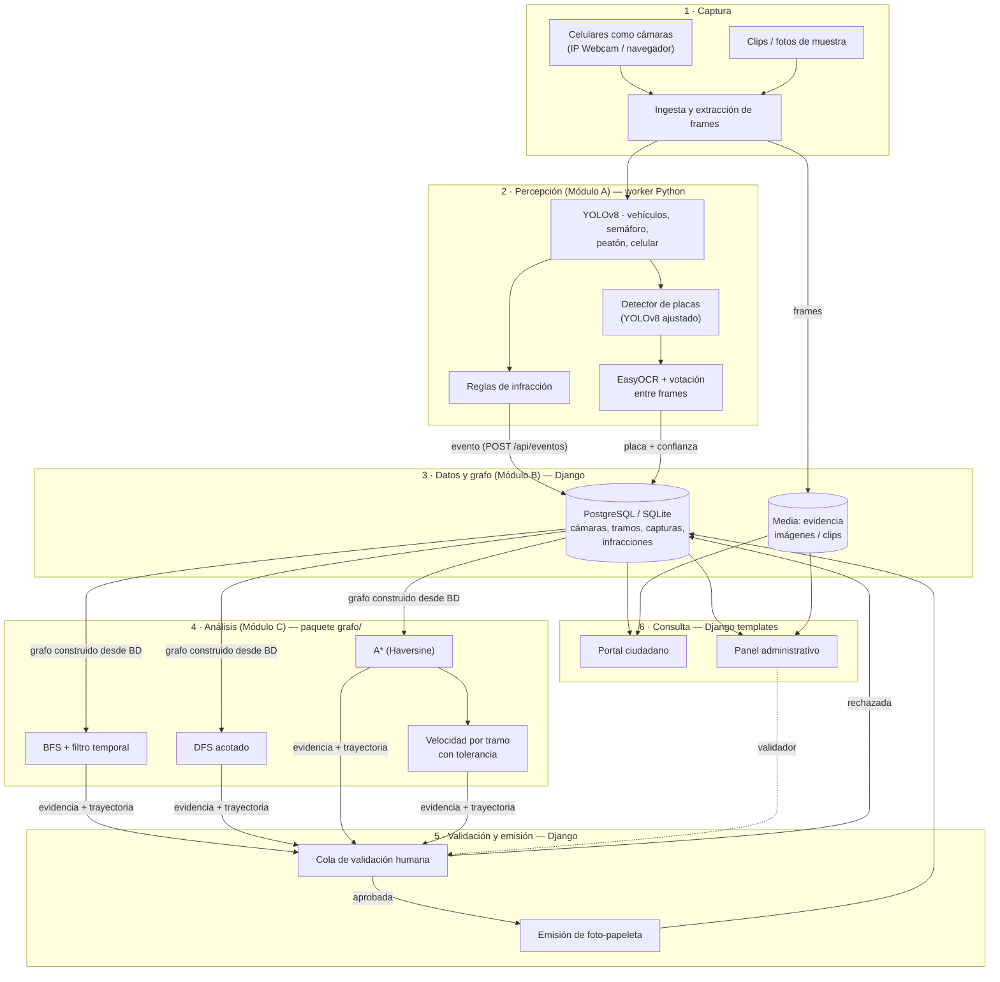
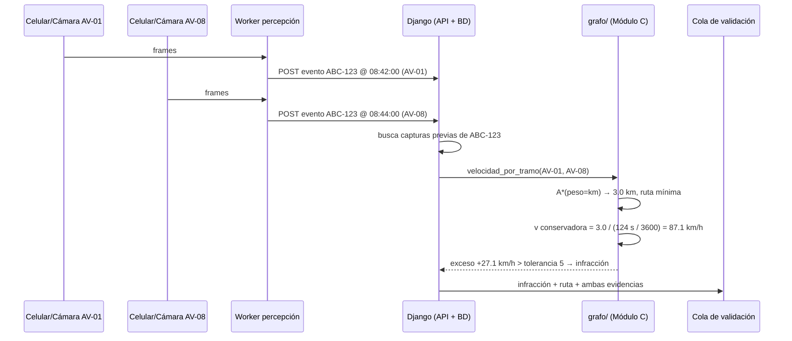
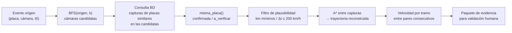
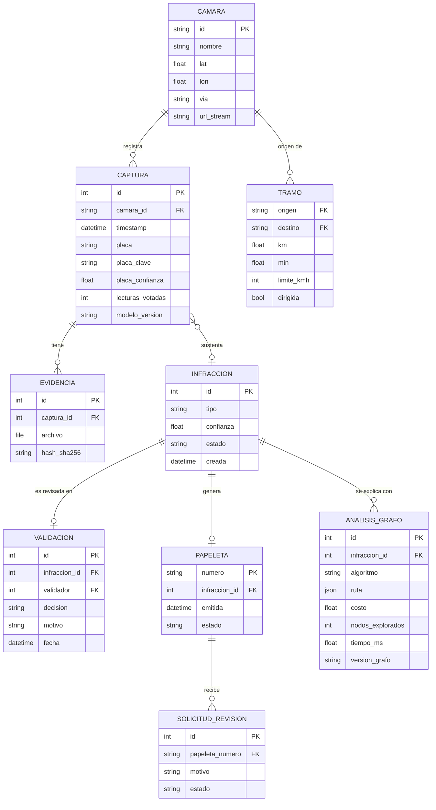
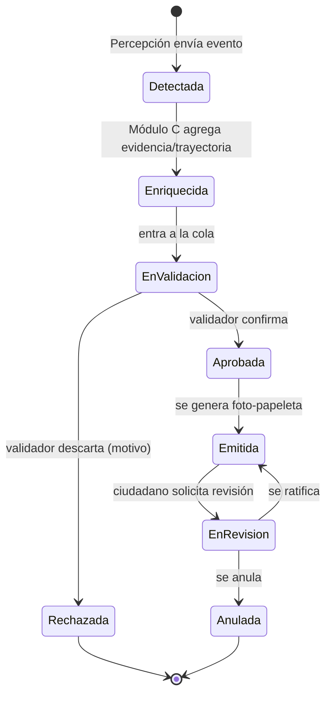

# FotoPapeleta Inteligente — Arquitectura del sistema

**Documento derivado de:** `plan_fotopapeleta_inteligente.md`
**Paper:** *Hacia una Fiscalización Vial Inteligente: Detección de Infracciones y Seguimiento Vehicular mediante Algoritmos de Búsqueda*
**Metodología:** CRISP-DM · **Entrega:** APF2 (UTP)
**Responsable de arquitectura e integración:** Tonny Gabriel Hinostroza Palaco
**Versión:** 2.0 — incluye Django como backend, captura con celulares y correcciones al algoritmo.

> Este documento define **cómo está construido el sistema**: capas, componentes, datos, flujos, interfaces, tecnología y decisiones de diseño. El plan maestro define *qué* y *por qué*; este documento define *cómo*.

---

## 1. Visión general

FotoPapeleta Inteligente convierte imágenes de cámaras de tránsito en **foto-papeletas trazables y validadas por un humano**. Su rasgo distintivo es que, además de detectar la infracción en una cámara, **modela la red de cámaras como un grafo ponderado** y la recorre con **BFS, DFS y A\*** para:

1. **Recuperar evidencia adicional** (¿en qué otras cámaras apareció la misma placa?).
2. **Reconstruir la trayectoria** del vehículo entre dos capturas.
3. **Demostrar el exceso de velocidad por tramo** (*section speed*) usando la ruta mínima como cota inferior.

**Principio rector:** el grafo **no detecta** infracciones; **vincula, rastrea y recupera** evidencia. Ninguna papeleta se emite sin **validación humana**.

### 1.1 Principios de arquitectura

| # | Principio | Consecuencia en el diseño |
|---|---|---|
| P1 | **Humano en el bucle** | Toda infracción pasa por una cola de validación antes de emitirse. |
| P2 | **Trazabilidad de extremo a extremo** | Cada papeleta enlaza a sus eventos, imágenes, versión de modelo, ruta calculada y validador. |
| P3 | **Desacople por eventos** | Percepción y Análisis solo se comunican mediante el *evento* `(placa, cámara, hora, …)`. Se pueden probar por separado. |
| P4 | **Núcleo algorítmico puro y reproducible** | El paquete `grafo/` (Módulo C) no depende de YOLO, Django ni de la BD: entra un diccionario, salen resultados y métricas. Lo usan igual el notebook del paper y la web. |
| P5 | **ML fuera de la petición web** | YOLO y el OCR corren en un *worker* aparte; Django nunca ejecuta inferencia dentro de una petición HTTP. |
| P6 | **Alcance honesto** | Percepción se demuestra con celulares y muestras usando modelos preentrenados; no se promete despliegue real de cámaras. |

---

## 2. Arquitectura por capas (6 capas)



Versión en texto (para el paper si no se renderiza Mermaid):

```
┌──────────────┐   frames   ┌────────────────────┐   evento    ┌──────────────────────┐
│ 1. CAPTURA   │──────────▶│ 2. PERCEPCIÓN (A)   │───────────▶│ 3. DATOS Y GRAFO (B)  │
│ celulares /  │            │ worker Python:      │  HTTP/JSON  │ Django + BD + media   │
│ clips        │            │ YOLO+placas+OCR     │             │                       │
└──────────────┘            └────────────────────┘             └──────────┬───────────┘
                                                                          │ evento + grafo
                                                                          ▼
┌──────────────┐  consulta  ┌────────────────────┐  aprobada   ┌──────────────────────┐
│ 6. CONSULTA  │◀──────────│ 5. VALIDACIÓN Y     │◀───────────│ 4. ANÁLISIS (C)       │
│ portal/panel │            │    EMISIÓN (humano) │  evidencia  │ BFS · DFS · A* · vel. │
└──────────────┘            └────────────────────┘             └──────────────────────┘
```

**Flujo de datos:** `Captura → Percepción → (evento) → Grafo/Análisis → Validación → Emisión → Consulta`

### 2.1 Vista de despliegue (procesos)

```
┌──────────── Red Wi-Fi local ────────────┐
│  📱 Celular 1 = AV-01   📱 Celular 2 = AV-08 │
│  (app IP Webcam)        (app IP Webcam)       │
└──────────┬──────────────────┬───────────┘
           │ MJPEG http       │
┌──────────▼──────────────────▼───────────┐       ┌──────────────────────────────┐
│ PROCESO 1 — Worker de percepción          │ POST  │ PROCESO 2 — Django (+ DRF)    │
│ percepcion/worker.py                      │──────▶│ • API REST /api/...            │
│ OpenCV · YOLOv8 · detector de placas ·    │ token │ • Portal ciudadano             │
│ EasyOCR · votación de lecturas            │       │ • Panel admin + validación     │
└───────────────────────────────────────────┘       │ • importa paquete grafo/       │
                                                    └──────────────┬───────────────┘
                                                                   │ ORM
                                                    ┌──────────────▼───────────────┐
                                                    │ BD: SQLite (demo) /           │
                                                    │     PostgreSQL                │
                                                    │ media/: evidencias            │
                                                    └──────────────────────────────┘
```

- Son **dos procesos independientes**: si el worker se cae, la web sigue funcionando, y viceversa.
- El análisis del grafo tarda milisegundos, así que Django lo ejecuta **en la misma petición** que registra el evento. Solo la inferencia de ML va aparte.
- Celery con Redis **no es necesario para el APF2**. Se añadiría solo si se procesan videos subidos por la web en segundo plano.

---

## 3. Componentes por capa

### 3.1 Capa 1 — Captura (celulares como cámaras)

Cada celular representa **una cámara (un nodo del grafo)**. Con **dos celulares en dos puntos** se demuestran en vivo la lectura de placa, la reaparición del vehículo entre cámaras y la velocidad por tramo.

| Opción | Cómo funciona | Uso recomendado |
|---|---|---|
| **A. App IP Webcam (Android) / DroidCam** | El celular transmite video a una URL de la red local (`http://IP:8080/video`). OpenCV la lee como una cámara. | **Desarrollo y demo en vivo** |
| **B. Página web de captura** | Una vista de Django abre la cámara del navegador (`getUserMedia`) y envía fotos cada 0.5–1 s a `/api/frames/`. El worker las procesa. Requiere HTTPS (`ngrok` en la demo). | Opcional: funciona también en iPhone |
| **C. Fotos / videos grabados** | Se graban con el celular y se procesan después con el worker. | **Respaldo para la exposición** si falla el Wi-Fi |

```python
# percepcion/worker.py (esquema)
FUENTES = {"AV-01": "http://192.168.1.20:8080/video",
           "AV-08": "http://192.168.1.21:8080/video"}

cap = cv2.VideoCapture(FUENTES["AV-01"])
while True:
    ok, frame = cap.read()
    if not ok: break
    if n % SALTO_FRAMES == 0:                  # procesar 2–5 fps, no 30
        for evento in pipeline.procesar(frame, camara="AV-01", ts=now()):
            requests.post(API + "/api/eventos/", json=evento, headers=TOKEN)
```

**Condiciones de captura recomendadas:** celular fijo (trípode o soporte), distancia de 3 a 8 m a la placa, luz de día, ángulo poco inclinado. La hora del celular ya se sincroniza por la red; el error residual se absorbe con la tolerancia de velocidad (sección 5.4).

### 3.2 Capa 2 — Percepción (Módulo A, worker Python)

| Componente | Responsabilidad | Tecnología |
|---|---|---|
| Detector general | Localizar vehículo, semáforo, peatón, celular | YOLOv8 preentrenado (COCO) |
| **Detector de placas** | Localizar la placa dentro del vehículo. **COCO no tiene la clase “placa”**, por eso hace falta un modelo aparte. | YOLOv8 con pesos de placas (Roboflow Universe / Hugging Face), ajustado con 200–300 fotos de placas peruanas |
| Seguidor | Mantener la identidad del vehículo entre frames | ByteTrack (incluido en Ultralytics) |
| Motor de reglas | Convertir detecciones en **tipo de infracción** | Python (zonas, estado del semáforo, dirección) |
| OCR | Leer solo el **recorte de la placa** | EasyOCR (Tesseract para comparar) |
| Validación y votación | Validar el formato peruano y elegir la lectura más frecuente en 5–10 frames del mismo vehículo | Regex + conteo por `track_id` |

**Pipeline de lectura de placa:**

```
frame ─▶ YOLO (car/bus/truck) ─▶ recorte vehículo ─▶ detector de placas ─▶ recorte placa
      ─▶ preprocesado (escala de grises, ampliar ×2, contraste) ─▶ EasyOCR
      ─▶ normalizar + regex ^[A-Z0-9]{3}-?\d{3}$ ─▶ votación por track_id ─▶ placa final
```

**Reglas por tipo de infracción:**

| Infracción | Regla (resumen) | Requiere |
|---|---|---|
| Semáforo en rojo | Semáforo = rojo **y** vehículo cruza la línea de detención | Seguimiento + línea configurada |
| Invasión de cruce peatonal | *bbox* del vehículo intersecta el polígono del cruce con fase peatonal activa | Polígono de zona |
| Uso de celular | Objeto `cell phone` dentro de la región del conductor | Imagen con buena resolución |
| Giro prohibido | Trayectoria entra por zona A y sale por zona B prohibida | Seguimiento + zonas |
| Sentido contrario | Vector de desplazamiento opuesto a la dirección permitida | Seguimiento + dirección de vía |
| No respetar señales | Regla específica por señal configurada en la cámara | Configuración por cámara |
| Exceso de velocidad | **Forma 1:** píxeles/FPS calibrados (demostrativa). **Forma 2:** por tramo en la Capa 4 (principal) | Calibración / grafo |

**Salida — el evento (contrato entre capas):**

```json
{
  "evento_id": "EV-2026-000123",
  "placa": "ABC-123",
  "placa_confianza": 0.94,
  "lecturas_votadas": 7,
  "tipo": "exceso_velocidad",
  "tipo_confianza": 0.88,
  "camara_id": "AV-01",
  "timestamp": "2026-10-15T08:42:00-05:00",
  "evidencia": ["AV-01/20261015_084200_f1.jpg"],
  "modelo": {"detector": "yolov8n@1.0", "placas": "lp-yolov8@0.1", "ocr": "easyocr@1.7"}
}
```

### 3.3 Capa 3 — Datos y grafo (Módulo B, Django)

| Almacén | Contenido | Implementación |
|---|---|---|
| BD | Cámaras, tramos, capturas, infracciones, validaciones, papeletas | Modelos Django (SQLite en la demo, PostgreSQL después) |
| Evidencia | Frames y clips referenciados por ruta | `MEDIA_ROOT` de Django (`ImageField` / `FileField`) |
| Grafo de cámaras | **Fuente de verdad: tablas `Camara` y `Tramo`**, editables desde el panel admin | `camaras/servicios.py → construir_grafo()` arma el diccionario para el paquete `grafo/` |
| Grafo exportado | Copia versionada para el notebook del paper | `manage.py exportar_grafo > data/grafo_camaras.json` |
| Índice de capturas | `placa → [(cámara, timestamp)]` | Índice de BD sobre `(placa_normalizada, timestamp)` |

### 3.4 Capa 4 — Análisis (Módulo C, núcleo evaluado)

| Componente | Pregunta que responde | Salida |
|---|---|---|
| **BFS** | ¿Qué cámaras están a ≤ k saltos del origen? | `{camara: saltos}` (incluye el origen con 0) |
| **Filtro temporal** | ¿Qué capturas de esas cámaras son físicamente posibles en el tiempo transcurrido? | Capturas coherentes |
| **DFS acotado** | ¿Qué rutas existen de A a B (hasta `max_prof` y `max_rutas`)? | Lista de rutas candidatas |
| **A\*** | ¿Cuál es la ruta de menor costo entre A y B? | Ruta, costo, nodos explorados |
| **Coincidencia de placa** | ¿Es la misma placa, aunque el OCR haya confundido un carácter? | `confirmada` / `a_verificar` / no coincide |
| **Velocidad por tramo** | ¿Superó el límite entre dos capturas, aun en el peor caso? | v (km/h), exceso, booleano |
| **Recolector de métricas** | Nodos explorados, costo, evidencia, tiempo | Tabla reproducible |

### 3.5 Capa 5 — Validación y emisión (Django)

| Componente | Responsabilidad |
|---|---|
| Cola de validación | Infracciones pendientes ordenadas por confianza, antigüedad o gravedad. |
| Pantalla de validación (3 columnas) | Evidencia visual · datos del evento y lecturas de OCR · trayectoria en mapa (Leaflet) y decisión. |
| Decisión | **Aprobar** (con posibilidad de corregir la placa), **Rechazar** (con motivo) o **Escalar**. |
| Emisor | Genera la foto-papeleta con número único, evidencia y sello de auditoría (PDF opcional). |
| Auditoría | Registro de quién, cuándo, qué cambió y qué versión de modelo/grafo se usó. |

### 3.6 Capa 6 — Consulta (rehacer el prototipo HTML en Django)

El prototipo actual es **HTML básico**. Se migra a **plantillas de Django**: el mismo HTML se reutiliza como base y se le agregan datos reales, formularios y permisos.

| Módulo | Funcionalidades | Mejoras sobre el prototipo actual |
|---|---|---|
| Portal ciudadano | Consulta por placa · detalle con evidencia · solicitar revisión | Datos reales desde la BD; evidencia con placas de terceros difuminadas |
| Panel administrativo | Resumen/KPIs · cámaras · infracciones con filtros · validación en 3 columnas · reportes | Login y roles; mapa del grafo y trayectorias (Leaflet + OpenStreetMap); gráficos (Chart.js); cola que se actualiza sola (HTMX) |
| Admin de Django | CRUD de cámaras, tramos, usuarios | Gratis: viene incluido con Django |
| Laboratorio del grafo | Elegir origen/destino y ejecutar BFS/DFS/A\* en pantalla | Muy útil para la exposición: muestra el algoritmo en vivo |

**Frontend sin framework de JS:** Tailwind CSS v4 (diseño, con las variables del sistema de diseño) + HTMX (interactividad con el servidor sin escribir JavaScript complejo) + Alpine.js (dropdowns, modales, sidebar, tema) + Lucide (íconos) + Leaflet (mapa) + Chart.js (gráficos). Tailwind se compila con su ejecutable independiente (`django-tailwind-cli`); no hace falta Node ni React. El diseño de cada pantalla, los colores, la tipografía y los componentes están en `diseno_prototipo_pencil.md`.

---

## 4. Diseño del Módulo B — Grafo de cámaras

### 4.1 Modelo
- **Nodo = cámara**: `id`, `nombre`, `lat`, `lon`, `via`.
- **Arista = tramo de vía** conducible directamente entre dos cámaras.
- **Peso = `{km, min}`** + `limite_kmh` + `dirigida`.

### 4.2 Formato exportado

```json
{
  "version": "2026-10-15",
  "nodos": {
    "AV-01": {"nombre": "Av. Javier Prado", "lat": 0.0, "lon": 0.0},
    "AV-08": {"nombre": "Av. Arequipa",     "lat": 0.0, "lon": 0.0},
    "AV-02": {"nombre": "...",              "lat": 0.0, "lon": 0.0},
    "AV-12": {"nombre": "Av. Brasil",       "lat": 0.0, "lon": 0.0},
    "AV-15": {"nombre": "...",              "lat": 0.0, "lon": 0.0},
    "PN-04": {"nombre": "...",              "lat": 0.0, "lon": 0.0}
  },
  "aristas": [
    {"de": "AV-01", "a": "AV-08", "km": 3.0, "min": 4, "limite_kmh": 60, "dirigida": false},
    {"de": "AV-01", "a": "AV-02", "km": 2.1, "min": 3, "limite_kmh": 60, "dirigida": false},
    {"de": "AV-08", "a": "AV-15", "km": 4.5, "min": 6, "limite_kmh": 60, "dirigida": false},
    {"de": "AV-08", "a": "AV-12", "km": 3.8, "min": 5, "limite_kmh": 60, "dirigida": false},
    {"de": "AV-02", "a": "AV-12", "km": 5.2, "min": 7, "limite_kmh": 60, "dirigida": false},
    {"de": "AV-12", "a": "PN-04", "km": 6.0, "min": 8, "limite_kmh": 60, "dirigida": false}
  ]
}
```

> **Pendiente:** completar `lat`/`lon` de cada cámara con Google Maps u OpenStreetMap (semanas 1–2). Son necesarias para la heurística de A\* y para el mapa del panel. Si se usan celulares en la demo, los nodos AV-01 y AV-08 pueden ser **los puntos reales donde se colocan los celulares**, con la distancia real medida entre ellos.

### 4.3 Red de ejemplo

```
   AV-01 ──4 min / 3.0 km── AV-08 ──6 min / 4.5 km── AV-15
     │                        │
  3 min / 2.1 km          5 min / 3.8 km
     │                        │
   AV-02 ──7 min / 5.2 km── AV-12 ──8 min / 6.0 km── PN-04
```

### 4.4 Decisiones de modelado
- **Grafo dirigido:** las vías de doble sentido (`dirigida: false`) generan dos arcos; las de un sentido, uno solo. Esto permite modelar calles reales y es coherente con la infracción “sentido contrario”.
- **Peso configurable:** el motor recibe `peso="km"` o `peso="min"`. Para **velocidad por tramo** se usa **siempre `km`**; para trayectoria probable y filtro temporal, `min`.

```python
def construir_grafo(datos):
    grafo = {n: [] for n in datos["nodos"]}
    for a in datos["aristas"]:
        grafo[a["de"]].append((a["a"], a))
        if not a["dirigida"]:
            grafo[a["a"]].append((a["de"], a))
    return grafo
```

---

## 5. Diseño del Módulo C — Motor de búsqueda

### 5.1 Interfaz del paquete `grafo/` (Python puro)

```python
bfs(grafo, origen, k)                                   -> dict[camara, saltos]
dfs(grafo, origen, destino, max_prof=6, max_rutas=50)   -> list[list[camara]]
a_estrella(grafo, origen, destino, h, peso="km")        -> (ruta, costo, nodos_explorados)
velocidad_por_tramo(grafo, cam_a, t_a, cam_b, t_b, limite, h, ...) -> dict
capturas_coherentes(evento, candidatas, capturas, tiempo_min_a)    -> list[captura]
misma_placa(a, b)                                       -> "confirmada" | "a_verificar" | None
```

### 5.2 Algoritmos y su papel

| Algoritmo | Uso en el sistema | Complejidad | Nota de diseño |
|---|---|---|---|
| BFS | Vecindario a ≤ k saltos → dónde buscar la placa | O(V + E) | Por saltos; se complementa con filtro temporal. |
| DFS | Rutas alternativas A→B | Exponencial en el peor caso | Acotado con `max_prof` y `max_rutas`. |
| A\* | Ruta de menor costo; trayectoria; base de la velocidad | O(E log V) | Heurística Haversine admisible; conjunto cerrado. |

### 5.3 Heurística de A\*

La heurística debe estar **en las mismas unidades que el peso** y **no sobreestimar** el costo real:

| Peso | Heurística `h(n, destino)` | Admisible porque… |
|---|---|---|
| `km` | Distancia Haversine (línea recta) | Ninguna vía es más corta que la línea recta. |
| `min` | Haversine (km) / velocidad máxima de la red × 60 | Nadie cubre la línea recta más rápido que la velocidad máxima. |
| sin coordenadas | `h = 0` | A\* se reduce a Dijkstra: correcto, pero sin ventaja. |

```python
from math import radians, sin, cos, asin, sqrt

def haversine_km(a, b, nodos):
    lat1, lon1 = radians(nodos[a]["lat"]), radians(nodos[a]["lon"])
    lat2, lon2 = radians(nodos[b]["lat"]), radians(nodos[b]["lon"])
    h = sin((lat2 - lat1) / 2) ** 2 + cos(lat1) * cos(lat2) * sin((lon2 - lon1) / 2) ** 2
    return 2 * 6371 * asin(sqrt(h))

def h_min(a, b, nodos, vmax_kmh=80):
    return haversine_km(a, b, nodos) / vmax_kmh * 60
```

**Experimento para el paper:** ejecutar A\* con `h = 0` (Dijkstra) y con Haversine sobre los mismos pares origen–destino, y comparar los nodos explorados. Las dos versiones deben dar el mismo costo; Haversine debería explorar menos nodos.

### 5.4 Implementación de referencia

```python
import heapq
from collections import deque

def bfs(grafo, origen, k):
    visitados, cola = {origen: 0}, deque([origen])
    while cola:
        actual = cola.popleft()
        if visitados[actual] == k:
            continue
        for vecino, _ in grafo[actual]:
            if vecino not in visitados:
                visitados[vecino] = visitados[actual] + 1
                cola.append(vecino)
    return visitados

def dfs(grafo, actual, destino, max_prof=6, max_rutas=50, camino=None, rutas=None):
    camino = camino if camino is not None else []
    rutas = rutas if rutas is not None else []
    camino.append(actual)
    if actual == destino:
        rutas.append(list(camino))
    elif len(camino) <= max_prof and len(rutas) < max_rutas:
        for vecino, _ in grafo[actual]:
            if vecino not in camino:
                dfs(grafo, vecino, destino, max_prof, max_rutas, camino, rutas)
    camino.pop()
    return rutas

def a_estrella(grafo, origen, destino, h, peso="km"):
    abierto = [(h(origen, destino), origen)]
    g, padre, cerrados, explorados = {origen: 0}, {}, set(), 0
    while abierto:
        _, actual = heapq.heappop(abierto)
        if actual in cerrados:                  # descarta entradas obsoletas
            continue
        cerrados.add(actual)
        explorados += 1
        if actual == destino:
            ruta = [actual]
            while ruta[-1] in padre:
                ruta.append(padre[ruta[-1]])
            return ruta[::-1], g[destino], explorados
        for vecino, w in grafo[actual]:
            ng = g[actual] + w[peso]
            if ng < g.get(vecino, float("inf")):
                g[vecino], padre[vecino] = ng, actual
                heapq.heappush(abierto, (ng + h(vecino, destino), vecino))
    return None, float("inf"), explorados
```

**Validación:** `tests/` compara cada resultado con NetworkX (`nx.astar_path_length`, `nx.all_simple_paths`, `nx.single_source_shortest_path_length` con `cutoff=k`). NetworkX actúa como “oráculo”: si coinciden, la implementación propia queda demostrada como correcta.

### 5.5 Velocidad por tramo (*section speed*) con tolerancia



```python
def velocidad_por_tramo(grafo, cam_a, t_a, cam_b, t_b, limite, h,
                        error_reloj_s=2, tolerancia_kmh=5):
    ruta, km, _ = a_estrella(grafo, cam_a, cam_b, h, peso="km")
    dt_s = (t_b - t_a).total_seconds()
    if ruta is None or dt_s <= 0:
        return None
    v_medida = km / (dt_s / 3600)
    v_conservadora = km / ((dt_s + 2 * error_reloj_s) / 3600)   # a favor del conductor
    return {"ruta": ruta, "km": km,
            "v_medida": round(v_medida, 1),
            "v_conservadora": round(v_conservadora, 1),
            "exceso": round(v_conservadora - limite, 1),
            "infraccion": v_conservadora > limite + tolerancia_kmh}
```

**Argumento de prueba (doble garantía a favor del conductor):**
1. A\* garantiza que 3 km es la **distancia mínima** posible → cualquier otra ruta daría más velocidad.
2. Al tiempo medido se le **suma el posible error de reloj** de ambas cámaras → el tiempo usado es el máximo posible.

Con distancia mínima y tiempo máximo, 87.1 km/h es la **velocidad promedio más baja** que pudo tener el vehículo. Si aun así supera límite + tolerancia, la infracción no es discutible.

Si los tramos de la ruta tienen límites distintos, se usa el **límite más alto** de la ruta (también a favor del conductor).

### 5.6 Recuperación de evidencia (flujo completo)



```python
CONFUSIONES = str.maketrans({"O": "0", "Q": "0", "D": "0", "I": "1", "L": "1",
                             "B": "8", "S": "5", "Z": "2", "G": "6"})

def normalizar(p): return p.upper().replace("-", "").replace(" ", "")
def clave(p):      return normalizar(p).translate(CONFUSIONES)

def misma_placa(a, b):
    if normalizar(a) == normalizar(b):
        return "confirmada"
    if clave(a) == clave(b):
        return "a_verificar"            # nunca se emite sin revisión humana
    return None

def capturas_coherentes(evento, candidatas, capturas, tiempo_min_a, factor=0.5):
    ok = []
    for c in capturas:
        if c.camara in candidatas and c.camara != evento.camara:
            dt_min = abs((c.ts - evento.ts).total_seconds()) / 60
            if dt_min >= factor * tiempo_min_a(evento.camara, c.camara):
                ok.append(c)
    return ok
```

- **Filtro de plausibilidad:** una captura solo es coherente si, para recorrer la distancia mínima (A\* en km) en el tiempo observado, basta una velocidad de hasta **200 km/h**. Por encima se genera una alerta (posible placa clonada o error de OCR). *Versión anterior (descartada el 16/10/2026): exigir al menos la mitad del tiempo típico del tramo; trataba como imposibles a los autos que superaban el doble de la velocidad típica, es decir, a los infractores más graves.*
- **Coincidencia de placa:** la columna `placa_clave` se guarda en la BD con un índice, para buscar rápido las placas “parecidas”.

---

## 6. Modelo de datos (modelos Django)



### 6.1 Ciclo de vida de una infracción



---

## 7. Interfaces

### 7.1 API REST (Django REST Framework)

| Método | Ruta | Uso | Quién la llama |
|---|---|---|---|
| `POST` | `/api/eventos/` | Registrar un evento (dispara el análisis del grafo) | Worker de percepción (token) |
| `POST` | `/api/frames/` | Subir un frame desde la página de captura (opción B) | Navegador del celular |
| `GET` | `/api/grafo/` | Red de cámaras en GeoJSON (mapa) | Panel |
| `POST` | `/api/analisis/bfs/` | `{origen, k}` | Laboratorio del grafo |
| `POST` | `/api/analisis/dfs/` | `{origen, destino, max_prof}` | Laboratorio del grafo |
| `POST` | `/api/analisis/astar/` | `{origen, destino, peso, heuristica}` | Laboratorio del grafo |
| `POST` | `/api/analisis/velocidad/` | `{cam_a, t_a, cam_b, t_b}` | Laboratorio del grafo |

### 7.2 Vistas web (plantillas Django)

| Ruta | Pantalla | Rol |
|---|---|---|
| `/` | Consulta por placa | Público |
| `/papeleta/<num>/` | Detalle con evidencia y solicitud de revisión | Público |
| `/panel/` | Resumen y KPIs | Validador / admin |
| `/panel/camaras/` | Cámaras y mapa del grafo | Admin |
| `/panel/infracciones/` | Listado con filtros | Validador / admin |
| `/panel/validacion/` | Cola y pantalla de 3 columnas | Validador |
| `/panel/laboratorio/` | Ejecutar BFS/DFS/A\* y velocidad en vivo | Admin (demo) |
| `/panel/reportes/` | Reportes y exportación | Admin |
| `/captura/<camara>/` | Página de captura desde el navegador del celular | Operador |
| `/admin/` | Admin de Django (CRUD) | Admin |

---

## 8. Stack tecnológico

| Capa | Tecnología | Justificación |
|---|---|---|
| Lenguaje | **Python 3.11+** | Ecosistema de visión, grafos y web en un solo lenguaje |
| Captura | App IP Webcam / DroidCam, OpenCV | Celulares como cámaras sin desarrollar una app |
| Detección | **Ultralytics YOLOv8** (COCO + modelo de placas) | Preentrenado; ajuste fino ligero con Roboflow |
| Seguimiento | ByteTrack (Ultralytics) | Votación de OCR, giro, sentido contrario |
| OCR | **EasyOCR** (Tesseract como comparación) | Permite reportar CER comparativo |
| Grafos | Implementación propia + **NetworkX** como oráculo de pruebas | El paper evalúa el algoritmo propio |
| Backend | **Django 5 + Django REST Framework** | Ver sección 9 |
| BD | SQLite (demo) → PostgreSQL | Cero configuración en el APF2 |
| Frontend | Plantillas Django (+ `django-cotton`) + **Tailwind CSS v4 + HTMX + Alpine.js + Lucide + Leaflet + Chart.js** | Mejora el prototipo HTML sin aprender React; el diseño de pencil.dev pasa casi directo a Tailwind |
| Diseño | **pencil.dev** con variables de tema `mode` (claro/oscuro) y `density` | Especificación en `diseno_prototipo_pencil.md` |
| Experimentos | Jupyter Notebook | Entregable de “avance del algoritmo” |
| Pruebas | pytest | Casos del plan + comparación con NetworkX |
| Métricas | `time.perf_counter`, `jiwer` (CER), `ultralytics val` (mAP) | Reproducibles |
| Demo remota | ngrok | HTTPS para la cámara del navegador (opción B) |

---

## 9. ¿Django o FastAPI? — Decisión

| Criterio | Django + DRF | FastAPI | Peso para este proyecto |
|---|---|---|---|
| Portal + panel con HTML | **Plantillas integradas**; el prototipo HTML se reutiliza directamente | Hay que montar Jinja2 a mano o hacer un frontend aparte | **Alto** (el prototipo es HTML básico) |
| Login, roles, permisos | **Incluidos** | Hay que implementarlos | **Alto** (validador vs. ciudadano) |
| Panel de administración | **Admin automático** para cámaras, tramos, usuarios | No existe | **Alto** |
| BD y migraciones | ORM + migraciones incluidos | SQLAlchemy + Alembic, configurados a mano | Medio |
| Subida de evidencias | `ImageField` + `MEDIA_ROOT` | Manual | Medio |
| Rendimiento / async | Suficiente para el volumen del proyecto | Superior | **Bajo** (la carga pesada está en el worker, no en la web) |
| Servir el modelo ML | No debe hacerlo dentro de la petición | Algo más cómodo | **Bajo** (el ML va en el worker de todos modos) |
| Curva de aprendizaje | Más conceptos al inicio, mucha documentación en español | Muy simple para APIs | Medio |

**Decisión: Django + Django REST Framework.**

FastAPI es mejor cuando el backend es **solo una API** y el frontend es una aplicación aparte (React/Vue), o cuando se sirve el modelo de ML con mucha concurrencia. Ninguno de los dos casos aplica aquí:

- El ML corre en un **worker aparte**, así que la velocidad del framework web no importa.
- El prototipo es **HTML básico**: con Django se convierte en plantillas con datos reales sin escribir un frontend separado.
- Login, roles, admin y migraciones vienen hechos. Con FastAPI el equipo tendría que construir todo eso, y es justo lo que el panel administrativo y la validación humana necesitan.

> Si en el futuro se necesitara un servicio de inferencia en tiempo real con alta concurrencia, se puede agregar un microservicio FastAPI **solo para el ML**, sin cambiar el resto. La arquitectura lo permite porque Percepción ya está desacoplada (P3, P5).

---

## 10. Estructura del repositorio

```
fotopapeleta/
├── grafo/                          # Módulo C — Python puro, sin Django (Carlos)
│   ├── busqueda.py                 # bfs, dfs, a_estrella
│   ├── heuristicas.py              # haversine_km, h_min
│   ├── velocidad.py                # velocidad_por_tramo
│   ├── evidencia.py                # misma_placa, capturas_coherentes
│   └── modelo.py                   # construir_grafo, validar JSON
├── percepcion/                     # Módulo A — worker (Yazid / Rodrigo)
│   ├── worker.py                   # lee celulares/clips y envía eventos
│   ├── detector.py                 # YOLO vehículos + placas
│   ├── ocr.py                      # EasyOCR + regex + votación
│   ├── reglas.py                   # reglas de infracción
│   └── modelos/                    # pesos .pt (no subir a git si pesan mucho)
├── web/                            # Proyecto Django (Rodrigo / Tonny)
│   ├── manage.py
│   ├── config/                     # settings, urls
│   ├── camaras/                    # Camara, Tramo, construir_grafo() desde BD
│   ├── infracciones/               # Captura, Evidencia, Infraccion, AnalisisGrafo
│   ├── validacion/                 # Validacion, Papeleta, SolicitudRevision
│   ├── portal/                     # vistas públicas (consulta por placa)
│   ├── panel/                      # panel admin, laboratorio del grafo
│   ├── api/                        # serializers y vistas DRF
│   ├── templates/                  # HTML del prototipo migrado
│   └── static/                     # CSS/JS propios
├── data/
│   ├── grafo_camaras.json          # exportado desde la BD, versionado
│   ├── eventos_demo.json           # eventos sintéticos
│   └── muestras/                   # fotos/clips de prueba
├── evaluacion/                     # Juan Diego
│   ├── metricas.py
│   └── resultados.ipynb            # tabla de resultados del paper
├── tests/
│   ├── test_busqueda.py            # caso ABC-123 + comparación con NetworkX
│   ├── test_velocidad.py
│   └── test_placas.py
├── requirements.txt
└── docs/
    ├── plan_fotopapeleta_inteligente.md
    └── arquitectura_fotopapeleta_inteligente.md
```

---

## 11. Atributos de calidad y aspectos transversales

| Atributo | Cómo se atiende |
|---|---|
| **Trazabilidad** | Cada papeleta guarda: capturas, hash SHA-256 de cada imagen, versión de modelos, versión del grafo, ruta A\*, validador y fecha. |
| **Exactitud / bajo falso positivo** | Umbrales de confianza; votación de OCR entre frames; velocidad conservadora con tolerancia; coincidencias difusas solo “a verificar”; validación humana obligatoria. |
| **Reproducibilidad** | Grafo exportado y eventos de demo versionados en JSON; notebook que regenera la tabla de resultados; tests contra NetworkX. |
| **Rendimiento** | ML en un worker a 2–5 fps; BFS/A\* en milisegundos; DFS acotado. |
| **Disponibilidad** | Worker y web son procesos independientes; la demo tiene respaldo con videos grabados. |
| **Seguridad** | Roles de Django (ciudadano, validador, administrador); token para el worker; CSRF y sesiones de Django; el portal solo muestra la placa consultada. |
| **Privacidad y marco legal** | Ley N.° 29733 de Protección de Datos Personales (Perú): difuminar rostros y placas de terceros en la evidencia pública; retención limitada; en la demo, usar vehículos propios o con consentimiento. |
| **Integridad de evidencia** | Hash al momento de captura; la evidencia no se modifica, solo se referencia. |
| **Sincronización temporal** | Hora de red en celulares / NTP en cámaras; el error se incorpora en la velocidad conservadora. |
| **Mantenibilidad** | Módulos A, B y C independientes con contratos JSON; el paquete `grafo/` no depende de Django. |

---

## 12. Escenario integrado (demo de extremo a extremo)

```
1. Captura      Celular 1 (AV-01) transmite; a las 08:42:00 pasa ABC-123
                Celular 2 (AV-08) transmite; a las 08:44:00 pasa ABC-123
2. Percepción   Worker: YOLO detecta auto → detector de placas → EasyOCR
                votación de 7 lecturas → "ABC-123" (conf. 0.94) en ambas
3. Datos        POST /api/eventos/ ×2 → Django guarda 2 capturas + evidencias
4. Análisis
   BFS(AV-01, k=2)     -> {AV-01:0, AV-08:1, AV-02:1, AV-15:2, AV-12:2}
   DFS(AV-01 -> PN-04) -> [AV-01, AV-08, AV-12, PN-04]   (12.8 km)
                          [AV-01, AV-02, AV-12, PN-04]   (13.3 km)
   A*(AV-01 -> AV-08)  -> ruta [AV-01, AV-08], costo 3.0 km
                          nodos explorados: 3 con h=0 (Dijkstra);
                          con Haversine, el valor se obtiene al ejecutar
   velocidad_por_tramo -> medida 90.0 km/h; conservadora 87.1 km/h
                          límite 60, exceso +27.1 > tolerancia 5 → INFRACCIÓN
   evidencia           -> 2 cámaras con captura confirmada de ABC-123
5. Validación   El validador ve ambas imágenes + ruta en el mapa → Aprueba
6. Emisión      Se genera papeleta N.° FP-2026-000123
7. Consulta     El ciudadano consulta "ABC-123" en el portal y ve la evidencia
```

> En la demo real con celulares, las distancias y tiempos serán otros (por ejemplo, 150 m en un estacionamiento). Lo importante es que el flujo completo funcione; el ejemplo de Lima sirve para el paper.

---

## 13. Trazabilidad de la arquitectura

### 13.1 Objetivos → componentes
| Objetivo | Componentes que lo cumplen |
|---|---|
| OE1: detectar y registrar infracciones (placa, tipo, fecha, hora, ubicación, evidencia) | Capas 1–3: celulares, worker (YOLO + placas + OCR), Django (BD + evidencia) |
| OE2: BFS/DFS/A\* para localizar evidencia y analizar trayectorias | Capas 3–4: grafo desde BD, paquete `grafo/`, recuperación de evidencia, velocidad por tramo |

### 13.2 CRISP-DM → capas
| Fase CRISP-DM | Capa / artefacto |
|---|---|
| 1. Comprensión del negocio | Reglas de infracción, principios P1–P6 |
| 2. Comprensión de los datos | Muestras capturadas con celular, topología de cámaras |
| 3. Preparación de los datos | Etiquetado de placas (Roboflow), `grafo_camaras.json` con coordenadas |
| 4. Modelado | Módulo A (YOLO + placas + OCR) y Módulo C (BFS/DFS/A\*) |
| 5. Evaluación | `evaluacion/resultados.ipynb` + tests contra NetworkX |
| 6. Despliegue | Worker + Django + validación humana + portal |

### 13.3 Métricas → componente que las produce
| Métrica | Componente |
|---|---|
| Precisión / exhaustividad / mAP (vehículos y placas) | Detectores (Capa 2) |
| CER / acierto de placa completa (con y sin votación) | OCR (Capa 2) |
| Nodos explorados (h=0 vs Haversine), costo, tiempo | Motor de búsqueda (Capa 4) |
| Evidencia recuperada (confirmada / a verificar) | Recuperación de evidencia (Capa 4) |
| km/h medida, conservadora y exceso | Velocidad por tramo (Capa 4) |

### 13.4 Equipo → componentes
| Integrante | Componentes |
|---|---|
| Tonny Hinostroza | Arquitectura, contratos entre módulos, integración, proyecto Django base |
| Carlos Mayta | Paquete `grafo/` (BFS/DFS/A\*, heurísticas, velocidad, evidencia) y sus tests |
| Yazid Acosta | Detector YOLO, modelo de placas, dataset (Roboflow), reglas |
| Rodrigo Sequeiros | OCR + votación, worker de captura con celulares, API DRF |
| Juan Diego Chumpitaz | Evaluación, métricas, notebook de resultados, formato IEEE |

> La migración del prototipo HTML a plantillas Django se reparte entre Tonny y Rodrigo; el laboratorio del grafo, entre Tonny y Carlos.

---

## 14. Decisiones de arquitectura (ADR resumidos)

| ID | Decisión | Alternativa descartada | Motivo |
|---|---|---|---|
| ADR-01 | El núcleo evaluable es el **Módulo C** (grafo + búsqueda) | Entrenar un detector propio | 100 % implementable y medible en el plazo del APF2 |
| ADR-02 | **YOLO preentrenado + modelo de placas + OCR** sobre celulares y muestras | Despliegue con cámaras reales | Fuera del alcance universitario |
| ADR-03 | Comunicación entre módulos por **evento JSON** | Acoplamiento directo | Permite probar el grafo con eventos sintéticos |
| ADR-04 | Grafo **dirigido** con pesos `{km, min}` | No dirigido, un solo peso | Vías de un sentido; km para velocidad, min para tiempo |
| ADR-05 | **Velocidad por tramo conservadora** como método principal | Velocidad por clip (calibración) | Reproducible; A\* + margen de reloj la vuelven indiscutible |
| ADR-06 | **Validación humana obligatoria** | Emisión automática | Reduce falsos positivos y da respaldo legal |
| ADR-07 | BFS/DFS/A\* **propios**, validados contra NetworkX | Usar solo NetworkX | El paper evalúa el algoritmo; NetworkX sirve de oráculo |
| ADR-08 | **Django + DRF** como backend y web | FastAPI | Plantillas, auth, admin y ORM incluidos; el ML va aparte (sección 9) |
| ADR-09 | **Worker de percepción separado** de la web | Inferencia dentro de Django | YOLO bloquearía las peticiones web |
| ADR-10 | **Celulares como cámaras** (IP Webcam) | Comprar cámaras IP | Costo cero; permite demo de velocidad por tramo con dos nodos |
| ADR-11 | **Plantillas Django + Tailwind + HTMX + Alpine.js** para el frontend; íconos **Lucide** | SPA en React o Angular (Angular Material) | El equipo parte de HTML básico; evita un segundo proyecto; Lucide existe para HTML, React y Angular si se migra después |
| ADR-12 | Grafo con **fuente de verdad en la BD** y exportación a JSON | Solo JSON | Editable desde el admin y reproducible para el paper |

---

## 15. Correcciones aplicadas al plan original

| # | Problema detectado | Solución aplicada | Sección |
|---|---|---|---|
| 1 | Heurística de A\* en unidades de tiempo pero peso en km | Haversine en km para `peso="km"`; Haversine / vmax para `peso="min"`; coordenadas en cada nodo | 5.3 |
| 2 | “Nodos explorados = 2” fijado a mano en el ejemplo | El valor sale de la ejecución; con `h = 0` son 3; se compara `h = 0` vs Haversine | 5.3, 12 |
| 3 | BFS del ejemplo omitía el origen | El resultado incluye `AV-01: 0`, igual que el pseudocódigo | 5.4, 12 |
| 4 | A\* sin conjunto cerrado | Se agrega `cerrados` y se descartan entradas obsoletas | 5.4 |
| 5 | DFS sin límite (explosión de rutas) | `max_prof` y `max_rutas` | 5.4 |
| 6 | BFS por saltos ignora el tiempo | Filtro temporal con tiempo mínimo de A\* en minutos | 5.6 |
| 7 | Grafo no dirigido | Grafo dirigido con atributo `dirigida` | 4.4 |
| 8 | Sin tolerancia ni margen de reloj en la velocidad | Velocidad conservadora (tiempo + error de reloj) y tolerancia | 5.5 |
| 9 | Errores de OCR rompen el vínculo entre cámaras | Votación entre frames + coincidencia difusa “a verificar” | 3.2, 5.6 |
| 10 | YOLO base no detecta placas | Modelo de placas dedicado (ajuste fino con placas peruanas) | 3.2 |

---

## 16. Riesgos de arquitectura y mitigación

| Riesgo | Impacto | Mitigación |
|---|---|---|
| OCR con baja precisión en placas peruanas | Vínculos perdidos entre cámaras | Modelo de placas ajustado, recorte + preprocesado, votación entre frames, coincidencia difusa |
| Wi-Fi inestable durante la exposición | Demo en vivo falla | Videos grabados con los mismos celulares como respaldo (opción C) |
| PC sin GPU | Inferencia lenta | YOLOv8n (versión ligera), 2–5 fps, resolución reducida |
| Cámara del navegador bloqueada (sin HTTPS) | Opción B no funciona | Usar opción A (IP Webcam) o ngrok |
| Grafo con distancias imprecisas | Velocidad por tramo errónea | Medir con Google Maps/OSM; documentar la fuente; tolerancia |
| Curva de aprendizaje de Django | Retraso del panel | Usar el admin de Django primero; migrar el prototipo pantalla por pantalla |
| Alcance excesivo | Retraso del APF2 | Prioridad: paquete `grafo/` + tests → API → panel de validación → resto |

---

## 17. Hoja de ruta de implementación

| Paso | Entregable | Depende de |
|---|---|---|
| 1 | Paquete `grafo/` + tests contra NetworkX + notebook con métricas | Grafo con coordenadas |
| 2 | Proyecto Django: modelos, admin, carga del grafo, `/api/eventos/` | — |
| 3 | Worker con clips grabados → eventos en Django | Paso 2 |
| 4 | Modelo de placas + OCR con votación | Fotos etiquetadas |
| 5 | Worker con celulares en vivo (IP Webcam) | Pasos 3–4 |
| 6 | Migrar el prototipo HTML: portal, panel, validación, laboratorio del grafo, mapa | Paso 2 |
| 7 | Demo integrada con dos celulares + tabla de resultados para el paper | Todos |

**Prioridad para la nota:** los pasos 1 y 7 cubren directamente el “avance del algoritmo” (5 pts). El paso 6 refuerza la exposición (3 pts).

---

## 18. Decisiones abiertas

1. **Coordenadas de las cámaras:** quién las levanta y con qué fuente (Google Maps / OSM).
2. **Lugar de la demo con celulares:** dónde se colocan los dos puntos y cuál es la distancia real entre ellos.
3. **Dataset de placas:** usar pesos públicos tal cual o ajustarlos con fotos propias de placas peruanas.
4. **Prototipo web como entregable formal de “despliegue”** en el paper, o solo como apoyo de la exposición.
5. **Fecha real de entrega del APF2:** necesaria para fijar la hoja de ruta.
