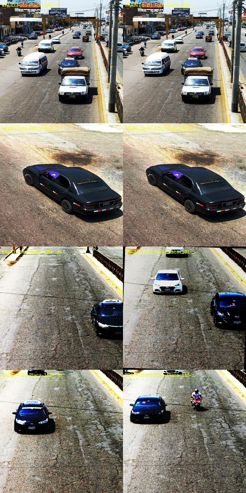
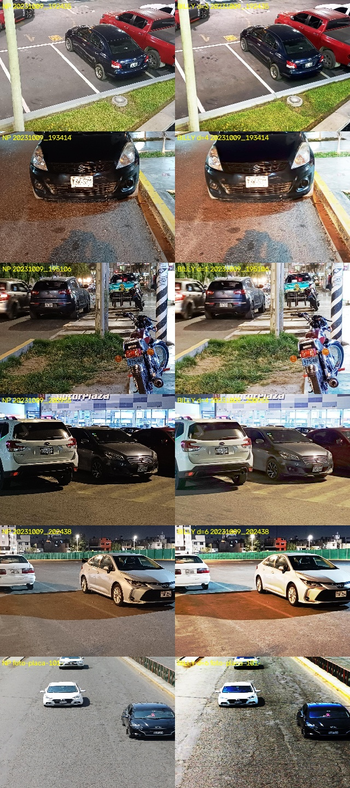

# 03 · Datos y control de fugas

## Objetivo
Conseguir imágenes de placas peruanas sin grabar material propio, y asegurar que las imágenes de evaluación no aparezcan (ni casi idénticas) en el entrenamiento.

## 1. Búsqueda de datasets

| Fuente | Resultado |
|---|---|
| Hugging Face (búsquedas: *peru*, *peruvian*, *placas*, *license plate peru*, *placa vehicular*) | Ningún dataset de placas peruanas |
| Hugging Face: *Vehicle Registration Plates* (`keremberke/license-plate-object-detection`) | 8 823 imágenes, CC BY 4.0, descargable sin cuenta. Placas de varios países. **No se usó** al aparecer uno peruano |
| Roboflow Universe: **Peru License Plate** (Billy Soplin, 2024) | **Elegido**. Ver detalle abajo |
| Roboflow Universe: **NumberPlates** (modelidentity-kq0nu) | **Descartado**: duplica a Peru License Plate (sección 4) |

**Peru License Plate — verificado con capturas de la página:**

| Dato | Valor |
|---|---|
| Licencia | CC BY 4.0 |
| Imágenes | 1 000 originales; la versión 9 tiene 2 626 con aumentos |
| Clase | `placa` (una sola) |
| Contenido | Calles de Lima, taxis, combis, estacionamientos; muchas fotos desde altura |
| Versión usada | **v9** (2024-10-17), 640 × 640, exportada en formato YOLOv9 (mismas etiquetas que YOLOv8) |
| División original | 2 445 entrenamiento / 128 validación / 53 prueba |
| Modelo publicado | `peru-license-plate/3`, entrenado sobre la v3 (320 × 240): mAP@50 85.6 %, precisión 89.7 %, exhaustividad 75.8 % |
| Etiquetas | La mayoría son **polígonos** (formato de segmentación), no cajas |

Se descartó la v3 pese a ser la del modelo publicado: a 320 × 240 una placa vista desde lejos queda de muy pocos píxeles.

## 2. Auditoría de la división original

Script: [`percepcion/datos/auditar_duplicados.py`](../../percepcion/datos/auditar_duplicados.py). Compara cada imagen de validación y prueba con todas las de entrenamiento de dos formas:
- **Por nombre de origen:** Roboflow nombra las copias aumentadas como `<origen>.rf.<hash>.jpg`.
- **Por parecido visual:** *dHash* de 64 bits (también sobre la imagen volteada). Se consideran la misma foto si difieren en 6 bits o menos.

| Hallazgo | Validación (128) | Prueba (53) |
|---|---|---|
| Imágenes casi idénticas a una de entrenamiento | **17 (13 %)** | **4 (7.5 %)** |
| — de ellas, copias exactas (≤ 2 bits) | 9 en total | |
| — de ellas, misma cámara y mismo fondo (3–6 bits) | 12 en total | |
| Mismo origen repartido entre splits | 8 | 0 |

*Filas 1–2: la misma foto subida dos veces con distinto nombre (`Foto-Placa-368-` y `Foto-Placa-368-_jpg`), una en validación y otra en entrenamiento. Filas 3–4: autos **distintos** fotografiados desde la **misma cámara fija**; comparten el fondo completo.*

**Interpretación:**
- Las copias exactas son una fuga clara: el modelo se evalúa con fotos que ya vio.
- Las fotos de la misma cámara fija no muestran el mismo vehículo, pero comparten escenario. Repartirlas entre entrenamiento y prueba premia que el modelo reconozca el lugar, no la placa. Agruparlas es la opción más estricta.
- Por esto, el mAP@50 de 85.6 % publicado **puede estar sobreestimado**. No se puede afirmar cuánto: también usa otra resolución y otra versión de los datos.

## 3. División propia sin fugas

Script: [`percepcion/datos/construir_split.py`](../../percepcion/datos/construir_split.py).
1. Une en un **grupo** las imágenes con el mismo origen o casi idénticas (unión transitiva).
2. Baraja los grupos con semilla fija (42) y asigna **cada grupo completo** a un solo split: 75 % entrenamiento, 15 % validación, 10 % prueba.
3. En validación y prueba deja **una sola imagen por grupo**, para que una foto con varias copias aumentadas no pese más.
4. Convierte polígonos en cajas, unifica las clases en `placa` y reduce las fotos de más de 1 280 px *(esto último se agregó después del entrenamiento; ver [05](05_incidencias_y_lecciones.md))*.

| | Entrenamiento | Validación | Prueba |
|---|---|---|---|
| Imágenes | 1 968 | 137 | 98 |
| Grupos | 2 626 imágenes de entrada → **927 grupos**; 23 grupos reúnen más de una foto de origen | | |
| Fugas tras la re-auditoría | **0** | **0** | **0** |

Datos: [`datos/reporte_split_peru_billy.json`](datos/reporte_split_peru_billy.json)

## 4. NumberPlates: por qué se descartó

| Dato | Valor |
|---|---|
| Licencia | CC BY 4.0 |
| Imágenes | 1 466 (1 319 entrenamiento, 0 validación, 147 prueba), fotos de 4000 × 3000 |
| Clases | **Dos clases equivalentes**: `Placa` y `placa` |
| Etiquetas | Polígonos |
| Fotos de origen | 489 |

**Hallazgo:** las **489 fotos de origen de NumberPlates están todas en Peru License Plate**, con el mismo nombre. Al agruparlos, 1 382 de sus 1 466 imágenes (94 %) quedaron en grupos compartidos con Billy, y el número de grupos pasó solo de 927 a 935.

*Izquierda: NumberPlates. Derecha: la imagen más parecida en Billy. Es la misma foto; solo cambian brillo y contraste por los aumentos de Billy.*

**Decisión:** no usarlo. No aporta fotos nuevas y, combinado sin control, habría puesto en la prueba fotos que el modelo vio en el entrenamiento.

*Nota:* las miniaturas de la página de Roboflow se ven oscuras y hacen parecer distintos ambos datasets; la comparación hay que hacerla con las imágenes completas.

## Lecciones para el paper (fase de preparación de CRISP-DM)
1. Las divisiones de los datasets públicos no se deben usar sin auditarlas.
2. Dos datasets públicos distintos pueden contener las mismas fotos.
3. Un control automático de duplicados (por nombre y por contenido) evita métricas infladas sin intervención manual.

## Tercer candidato: ProyectoYOLOUCSP (16/10/2026)
`data/ProyectoYOLOUCSP.v1-entrenamiento_ucsp.yolov9.zip` (Roboflow, workspace *jdvp*, CC BY 4.0): 2 637 imágenes, clase única `placa`, 4 526 objetos (4 401 como polígono). Son 985 fotos de origen, la mayoría con 3 versiones aumentadas (volteo horizontal y rotación de ±10°).

**Auditoría** con el mismo control (`python -m percepcion.datos.auditar_duplicados datasets/peru_billy datasets/ucsp`):
| | Fotos de origen |
|---|---|
| Mismo nombre de archivo que en Peru License Plate [21] | 843 |
| Distinto nombre pero visualmente idénticas (dHash ≤ 6 bits) | 139 |
| **Realmente nuevas** | **3** (`000089001W` y dos fotos de WhatsApp) |

**Decisión: descartado**, igual que NumberPlates. Es una copia reetiquetada de [21]: no aporta datos, y combinarlo pondría en entrenamiento las mismas fotos que están en nuestra prueba sin fugas (inflaría la métrica). Las 3 fotos nuevas no justifican un reentrenamiento. Quedó extraído en `datasets/ucsp/` (no se versiona).
