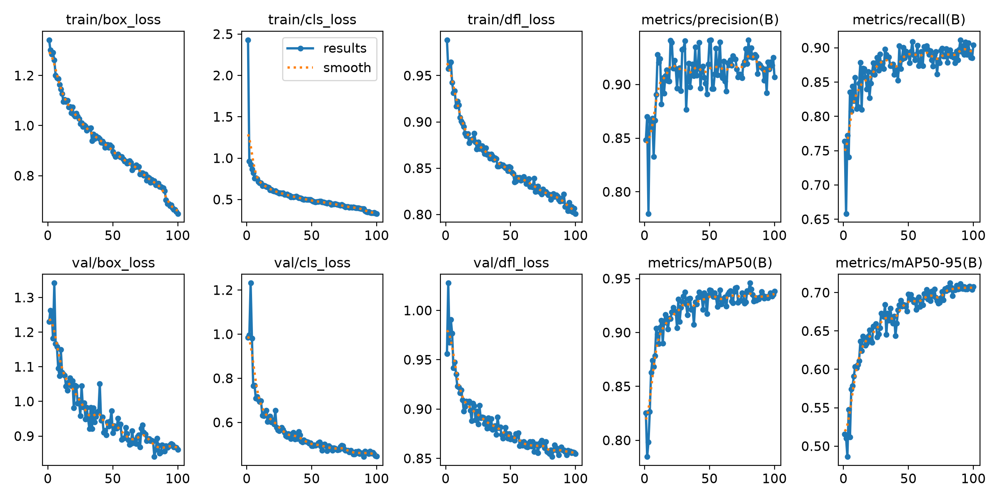
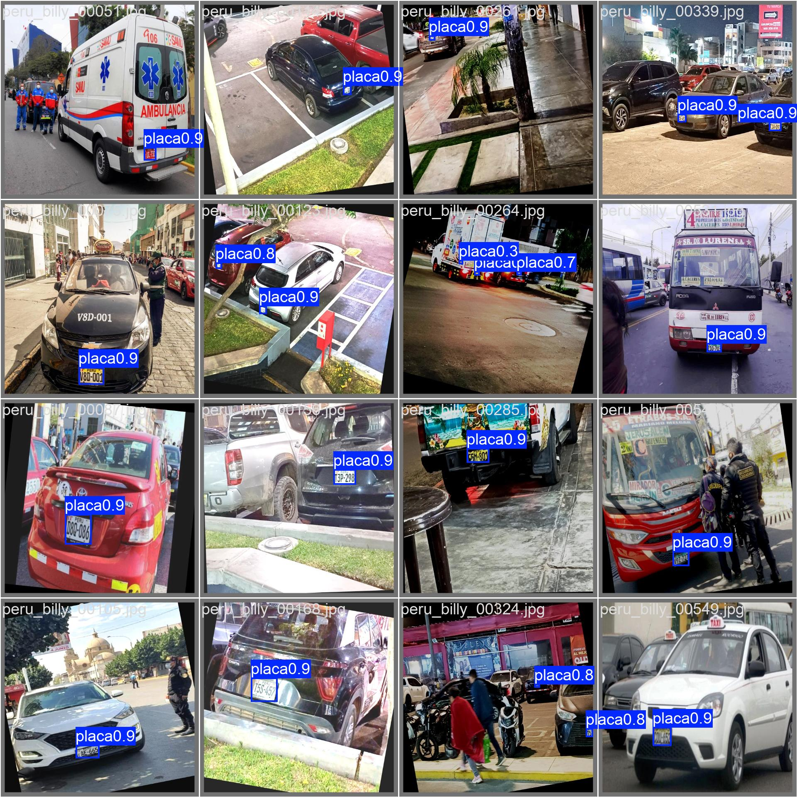

# 04 · Entrenamiento del detector de placas (YOLOv8n)

## Objetivo
Entrenar un detector que encuentre placas peruanas en imágenes de tránsito, y medirlo en una prueba sin fugas.

## Configuración

| Parámetro | Valor |
|---|---|
| Modelo base | `yolov8n.pt` (preentrenado en COCO): 3 011 043 parámetros, 8.2 GFLOPs; se transfirieron 349 de 355 capas |
| Datos | División propia sin fugas de *Peru License Plate* v9 ([03](03_datos_y_control_de_fugas.md)) |
| Tamaño de imagen | 640 × 640 |
| Épocas | 100 (parada anticipada con paciencia 20; no se activó) |
| Lote | 16 |
| Optimizador | Automático de Ultralytics, lr inicial 0.01, *weight decay* 0.0005, 3 épocas de calentamiento |
| Aumentos | Mosaico (se desactiva en las 10 últimas épocas), volteo horizontal 50 %, escala ±50 %, traslación 10 %, color HSV, *random erasing* 40 % |
| Precisión mixta (AMP) | Sí |
| Semilla | 42 (determinista) |
| Procesos de carga | 2 (con 4 el entrenamiento se colgó; ver [05](05_incidencias_y_lecciones.md)) |
| GPU | NVIDIA GeForce RTX 5070 |
| Duración | **20 min 33 s** (1 233 s) |

Configuración completa: [`datos/entrenamiento_yolov8n_args.yaml`](datos/entrenamiento_yolov8n_args.yaml)

**Datos efectivamente usados.** Ultralytics descartó 24 imágenes de entrenamiento y 1 de prueba porque sus etiquetas **mezclan cajas y polígonos** en el mismo archivo. Imágenes realmente usadas:

| Split | Imágenes | Placas | Imágenes sin placa |
|---|---|---|---|
| Entrenamiento | 1 944 (de 1 968) | — | 2 |
| Validación | 137 | 237 | 0 |
| Prueba | **97** (de 98) | **166** | 2 |

## Resultados finales (mejor modelo: época 82)

Ultralytics guarda como mejor modelo el de mayor `0.1 × mAP@50 + 0.9 × mAP@50-95` en validación.

| Conjunto | Imágenes | Placas | Precisión | Exhaustividad | mAP@50 | mAP@50-95 | ms/imagen |
|---|---|---|---|---|---|---|---|
| Validación | 137 | 237 | 93.4 % | 89.6 % | 94.1 % | 72.0 % | 2.6 |
| **Prueba sin fugas** | **97** | **166** | **95.6 %** | **91.3 %** | **96.5 %** | **75.0 %** | **1.9** |

**Cómo leerlo:**
- **Precisión 95.6 %:** de cada 100 cajas que marca el modelo, unas 96 son placas reales.
- **Exhaustividad 91.3 %:** encuentra unas 91 de cada 100 placas; se le escapan unas 9.
- **mAP@50 96.5 %:** calidad global de detección cuando basta con que la caja coincida al menos un 50 % con la real.
- **mAP@50-95 75.0 %:** misma medida pero exigiendo cajas cada vez más ajustadas; es la más estricta.
- **1.9 ms por imagen:** permite procesar video en tiempo real de varias cámaras con una sola GPU.

Datos: [`datos/detector_yolov8n_peru.json`](datos/detector_yolov8n_peru.json) · Pesos: `runs/placas/yolov8n_peru/weights/best.pt` (6.5 MB, no versionado)

## Evolución durante el entrenamiento



| Fase | Épocas | Qué pasó |
|---|---|---|
| Arranque | 1–5 | Ya en la época 1 alcanza mAP@50 82.5 % gracias al preentrenamiento en COCO. Las épocas 2–3 bajan (78.5 %–79.8 %) por el calentamiento del optimizador |
| Mejora rápida | 5–30 | mAP@50 sube de 86.3 % a 93.4 %; la exhaustividad pasa de 83.5 % a 87.8 % |
| Meseta | 30–80 | mAP@50 oscila entre 92 % y 94 %; mAP@50-95 sigue subiendo lento (67 % → 71 %), es decir, las cajas se ajustan mejor |
| Ajuste final | 90–100 | Sin mosaico (`close_mosaic=10`): la pérdida de entrenamiento baja de golpe, pero la validación casi no cambia |

**Observaciones:**
- **Sin sobreajuste:** la pérdida de validación baja hasta la época ~80 y luego se mantiene (box 0.84–0.88); no vuelve a subir.
- **Máximo de mAP@50 en validación:** 94.6 % en la época 81. El mejor modelo según el criterio de Ultralytics es el de la época 82.
- **La precisión fluctúa mucho** entre épocas (±3 puntos) porque la validación tiene solo 137 imágenes.
- **La parada anticipada no se activó:** el modelo siguió mejorando mAP@50-95 hasta el final. Con más épocas podría ganar algo más, pero muy poco.

## Lo que se ve en la prueba



*Predicciones del mejor modelo sobre imágenes de prueba que nunca vio. Detecta placas en ambulancias, taxis, combis, estacionamientos de noche y placas pequeñas lejanas.*

- La mayoría de las detecciones tienen confianza ≥ 0.8.
- **Error típico:** en escenas nocturnas con placas pequeñas y vehículos superpuestos (imagen `peru_billy_00264`) genera cajas solapadas con confianza baja (0.3). La supresión de duplicados y un umbral de confianza ≥ 0.5 en el sistema real lo evitan.
- Detecta también la placa pintada en el capó de un taxi ("V8D-001") como texto, pero solo marca la placa metálica: no confunde la rotulación con la placa.

| Figura | Archivo |
|---|---|
| Etiquetas reales del mismo lote | [img/test_lote0_real.jpg](img/test_lote0_real.jpg) |
| Curva precisión–exhaustividad (prueba) | [img/test_curva_pr.png](img/test_curva_pr.png) |
| Curva F1 según el umbral de confianza (prueba) | [img/test_curva_f1.png](img/test_curva_f1.png) |
| Matriz de confusión (prueba) | [img/test_matriz_confusion.png](img/test_matriz_confusion.png) |
| Distribución de tamaño y posición de las placas | [img/distribucion_etiquetas.jpg](img/distribucion_etiquetas.jpg) |
| Lote de entrenamiento con aumentos (mosaico) | [img/lote_entrenamiento_aumentos.jpg](img/lote_entrenamiento_aumentos.jpg) |

## Comparación con el modelo publicado

| Modelo | Resolución | Evaluación | mAP@50 | Precisión | Exhaustividad |
|---|---|---|---|---|---|
| `peru-license-plate/3` (Billy Soplin) | 320 × 240 | División original (con fugas) | 85.6 % | 89.7 % | 75.8 % |
| **YOLOv8n (este trabajo)** | 640 × 640 | **División propia sin fugas** | **96.5 %** | **95.6 %** | **91.3 %** |

**No es una comparación directa:** cambian la resolución, la versión de los datos y las imágenes de prueba. Lo que sí se puede afirmar es que nuestro modelo se evaluó con un protocolo más estricto (sin fugas) y aun así obtuvo métricas más altas.

## Limitaciones
1. **Prueba pequeña:** con 97 imágenes y 166 placas, el resultado puede variar varios puntos con otro grupo de fotos.
2. **Un solo dataset:** las fotos provienen de un mismo autor; el desempeño con nuestras cámaras (celulares en altura, de noche) está por medir.
3. **25 imágenes descartadas** por etiquetas mixtas. El script de división ya las corrige; un reentrenamiento las incluiría.
4. **Detecta, no lee:** este modelo solo encuentra la placa. La lectura (OCR) es el siguiente experimento.

## Las 100 épocas

Columnas: pérdidas de entrenamiento (caja, clase, DFL), métricas en validación y pérdidas de validación. ★ = mejor modelo guardado.

<details>
<summary>Ver tabla completa (100 filas)</summary>

| Época | Tiempo (s) | train box | train cls | train dfl | Precisión | Exhaustividad | mAP@50 | mAP@50-95 | val box | val cls | val dfl |
|---|---|---|---|---|---|---|---|---|---|---|---|
| 1 | 31 | 1.342 | 2.429 | 0.989 | 84.8 % | 76.4 % | 82.5 % | 51.6 % | 1.230 | 0.985 | 0.956 |
| 2 | 47 | 1.301 | 0.962 | 0.957 | 87.0 % | 65.8 % | 78.5 % | 51.0 % | 1.263 | 0.995 | 1.028 |
| 3 | 61 | 1.285 | 0.921 | 0.963 | 78.0 % | 77.2 % | 79.8 % | 48.6 % | 1.253 | 1.232 | 0.968 |
| 4 | 86 | 1.292 | 0.865 | 0.964 | 86.7 % | 74.1 % | 82.6 % | 54.8 % | 1.182 | 0.982 | 0.991 |
| 5 | 104 | 1.262 | 0.822 | 0.943 | 86.1 % | 83.5 % | 86.3 % | 51.2 % | 1.342 | 0.765 | 0.977 |
| 6 | 117 | 1.201 | 0.758 | 0.931 | 86.8 % | 80.7 % | 87.4 % | 57.4 % | 1.167 | 0.768 | 0.942 |
| 7 | 130 | 1.191 | 0.762 | 0.934 | 83.3 % | 84.4 % | 86.8 % | 57.9 % | 1.159 | 0.710 | 0.948 |
| 8 | 143 | 1.187 | 0.750 | 0.917 | 86.7 % | 82.3 % | 87.8 % | 59.1 % | 1.095 | 0.717 | 0.935 |
| 9 | 157 | 1.163 | 0.717 | 0.922 | 89.0 % | 85.7 % | 90.4 % | 60.4 % | 1.074 | 0.704 | 0.923 |
| 10 | 171 | 1.145 | 0.700 | 0.918 | 92.8 % | 81.1 % | 89.8 % | 60.2 % | 1.149 | 0.693 | 0.922 |
| 11 | 184 | 1.127 | 0.700 | 0.905 | 92.0 % | 81.4 % | 89.0 % | 60.6 % | 1.083 | 0.697 | 0.916 |
| 12 | 198 | 1.096 | 0.667 | 0.901 | 92.4 % | 84.8 % | 90.5 % | 61.1 % | 1.078 | 0.632 | 0.920 |
| 13 | 209 | 1.104 | 0.673 | 0.899 | 88.1 % | 87.9 % | 91.1 % | 63.6 % | 1.075 | 0.630 | 0.909 |
| 14 | 222 | 1.095 | 0.663 | 0.895 | 90.6 % | 81.0 % | 89.0 % | 62.4 % | 1.044 | 0.640 | 0.898 |
| 15 | 233 | 1.100 | 0.656 | 0.888 | 89.2 % | 87.0 % | 90.9 % | 64.3 % | 1.032 | 0.654 | 0.902 |
| 16 | 245 | 1.074 | 0.649 | 0.885 | 90.8 % | 86.9 % | 91.7 % | 64.1 % | 1.056 | 0.604 | 0.908 |
| 17 | 258 | 1.075 | 0.643 | 0.887 | 91.3 % | 85.7 % | 90.9 % | 63.1 % | 1.067 | 0.609 | 0.907 |
| 18 | 270 | 1.050 | 0.613 | 0.877 | 90.3 % | 84.0 % | 90.3 % | 63.4 % | 1.046 | 0.628 | 0.908 |
| 19 | 282 | 1.073 | 0.620 | 0.881 | 90.3 % | 86.5 % | 91.3 % | 64.3 % | 1.060 | 0.601 | 0.899 |
| 20 | 293 | 1.044 | 0.603 | 0.880 | 94.1 % | 82.7 % | 91.3 % | 65.2 % | 0.982 | 0.610 | 0.888 |
| 21 | 305 | 1.037 | 0.600 | 0.882 | 93.9 % | 84.8 % | 91.9 % | 63.8 % | 1.046 | 0.591 | 0.906 |
| 22 | 318 | 1.048 | 0.604 | 0.888 | 91.5 % | 86.4 % | 92.3 % | 63.5 % | 1.044 | 0.654 | 0.903 |
| 23 | 330 | 1.038 | 0.592 | 0.878 | 92.3 % | 87.8 % | 91.8 % | 65.6 % | 0.995 | 0.576 | 0.889 |
| 24 | 343 | 1.027 | 0.586 | 0.871 | 91.5 % | 86.1 % | 91.9 % | 65.6 % | 1.004 | 0.566 | 0.898 |
| 25 | 356 | 1.007 | 0.577 | 0.878 | 89.6 % | 87.8 % | 90.4 % | 65.9 % | 0.959 | 0.562 | 0.885 |
| 26 | 372 | 1.011 | 0.579 | 0.871 | 91.3 % | 88.6 % | 93.1 % | 64.2 % | 1.045 | 0.569 | 0.904 |
| 27 | 387 | 0.996 | 0.572 | 0.874 | 91.5 % | 86.7 % | 91.0 % | 64.6 % | 0.983 | 0.577 | 0.891 |
| 28 | 399 | 1.003 | 0.578 | 0.874 | 89.4 % | 89.1 % | 92.3 % | 65.4 % | 0.996 | 0.568 | 0.892 |
| 29 | 410 | 0.997 | 0.562 | 0.869 | 93.2 % | 87.2 % | 92.9 % | 67.3 % | 0.949 | 0.555 | 0.891 |
| 30 | 422 | 0.980 | 0.560 | 0.866 | 93.3 % | 87.8 % | 93.4 % | 67.0 % | 0.983 | 0.539 | 0.885 |
| 31 | 434 | 0.987 | 0.563 | 0.872 | 94.1 % | 86.9 % | 93.7 % | 66.9 % | 0.949 | 0.536 | 0.889 |
| 32 | 446 | 0.990 | 0.549 | 0.865 | 87.6 % | 89.8 % | 92.6 % | 68.4 % | 0.921 | 0.548 | 0.881 |
| 33 | 457 | 0.991 | 0.549 | 0.865 | 90.3 % | 89.0 % | 91.6 % | 64.5 % | 0.983 | 0.540 | 0.891 |
| 34 | 469 | 0.940 | 0.527 | 0.861 | 92.0 % | 88.6 % | 93.1 % | 67.3 % | 0.922 | 0.525 | 0.881 |
| 35 | 480 | 0.965 | 0.536 | 0.865 | 89.7 % | 88.6 % | 93.2 % | 66.4 % | 0.981 | 0.549 | 0.890 |
| 36 | 492 | 0.948 | 0.530 | 0.863 | 90.9 % | 87.3 % | 92.1 % | 68.0 % | 0.940 | 0.554 | 0.879 |
| 37 | 503 | 0.959 | 0.537 | 0.859 | 91.9 % | 87.3 % | 92.2 % | 66.8 % | 0.957 | 0.524 | 0.882 |
| 38 | 515 | 0.953 | 0.538 | 0.861 | 90.8 % | 87.6 % | 90.7 % | 66.0 % | 0.970 | 0.546 | 0.883 |
| 39 | 528 | 0.953 | 0.528 | 0.860 | 93.5 % | 86.1 % | 92.8 % | 66.9 % | 0.971 | 0.525 | 0.874 |
| 40 | 541 | 0.947 | 0.519 | 0.852 | 90.8 % | 86.9 % | 92.6 % | 64.4 % | 1.051 | 0.559 | 0.892 |
| 41 | 553 | 0.932 | 0.518 | 0.852 | 91.5 % | 86.5 % | 93.2 % | 66.0 % | 0.946 | 0.543 | 0.881 |
| 42 | 565 | 0.937 | 0.515 | 0.855 | 93.9 % | 85.2 % | 93.7 % | 67.7 % | 0.955 | 0.515 | 0.882 |
| 43 | 576 | 0.928 | 0.505 | 0.853 | 89.6 % | 90.3 % | 93.5 % | 68.4 % | 0.910 | 0.511 | 0.874 |
| 44 | 590 | 0.912 | 0.500 | 0.853 | 91.2 % | 86.9 % | 93.3 % | 69.0 % | 0.916 | 0.520 | 0.870 |
| 45 | 602 | 0.921 | 0.504 | 0.852 | 91.7 % | 88.3 % | 92.1 % | 68.2 % | 0.903 | 0.515 | 0.875 |
| 46 | 616 | 0.924 | 0.497 | 0.850 | 90.7 % | 90.1 % | 93.7 % | 68.4 % | 0.941 | 0.512 | 0.881 |
| 47 | 629 | 0.913 | 0.499 | 0.851 | 90.1 % | 88.5 % | 93.0 % | 68.4 % | 0.928 | 0.511 | 0.875 |
| 48 | 641 | 0.922 | 0.499 | 0.847 | 89.1 % | 89.5 % | 91.7 % | 68.2 % | 0.942 | 0.505 | 0.870 |
| 49 | 652 | 0.915 | 0.500 | 0.852 | 91.9 % | 89.0 % | 93.5 % | 67.5 % | 0.973 | 0.506 | 0.875 |
| 50 | 664 | 0.896 | 0.487 | 0.851 | 94.1 % | 89.0 % | 93.9 % | 69.8 % | 0.909 | 0.494 | 0.870 |
| 51 | 675 | 0.886 | 0.481 | 0.845 | 94.1 % | 87.8 % | 93.9 % | 69.2 % | 0.929 | 0.494 | 0.871 |
| 52 | 686 | 0.875 | 0.476 | 0.844 | 89.6 % | 89.5 % | 93.6 % | 69.8 % | 0.922 | 0.497 | 0.869 |
| 53 | 697 | 0.879 | 0.470 | 0.835 | 89.6 % | 90.9 % | 93.3 % | 69.1 % | 0.923 | 0.496 | 0.868 |
| 54 | 709 | 0.886 | 0.476 | 0.836 | 90.9 % | 89.0 % | 93.7 % | 68.8 % | 0.951 | 0.500 | 0.875 |
| 55 | 720 | 0.879 | 0.475 | 0.840 | 93.4 % | 88.2 % | 93.3 % | 68.8 % | 0.927 | 0.506 | 0.873 |
| 56 | 731 | 0.874 | 0.478 | 0.839 | 90.9 % | 89.0 % | 92.4 % | 67.8 % | 0.935 | 0.510 | 0.876 |
| 57 | 742 | 0.875 | 0.477 | 0.840 | 91.9 % | 90.4 % | 93.1 % | 69.2 % | 0.890 | 0.491 | 0.863 |
| 58 | 754 | 0.865 | 0.468 | 0.837 | 93.9 % | 87.3 % | 93.9 % | 69.4 % | 0.893 | 0.472 | 0.866 |
| 59 | 765 | 0.858 | 0.468 | 0.838 | 90.9 % | 87.8 % | 92.6 % | 68.2 % | 0.895 | 0.499 | 0.863 |
| 60 | 776 | 0.857 | 0.463 | 0.841 | 90.6 % | 89.5 % | 92.9 % | 68.9 % | 0.924 | 0.501 | 0.867 |
| 61 | 787 | 0.850 | 0.459 | 0.837 | 92.1 % | 87.3 % | 93.2 % | 68.4 % | 0.906 | 0.493 | 0.866 |
| 62 | 798 | 0.851 | 0.456 | 0.833 | 90.3 % | 90.2 % | 93.3 % | 69.9 % | 0.889 | 0.472 | 0.862 |
| 63 | 809 | 0.859 | 0.462 | 0.837 | 89.4 % | 89.9 % | 92.4 % | 69.4 % | 0.875 | 0.494 | 0.861 |
| 64 | 820 | 0.852 | 0.457 | 0.838 | 92.0 % | 90.3 % | 93.5 % | 70.4 % | 0.878 | 0.487 | 0.863 |
| 65 | 831 | 0.823 | 0.439 | 0.830 | 91.8 % | 89.7 % | 93.7 % | 69.1 % | 0.915 | 0.484 | 0.867 |
| 66 | 842 | 0.837 | 0.444 | 0.831 | 92.3 % | 89.0 % | 93.9 % | 69.8 % | 0.881 | 0.473 | 0.862 |
| 67 | 853 | 0.835 | 0.444 | 0.829 | 91.8 % | 89.6 % | 92.9 % | 69.0 % | 0.888 | 0.485 | 0.867 |
| 68 | 864 | 0.843 | 0.448 | 0.839 | 92.7 % | 88.2 % | 92.7 % | 70.2 % | 0.878 | 0.481 | 0.857 |
| 69 | 875 | 0.837 | 0.443 | 0.825 | 92.4 % | 87.3 % | 93.8 % | 69.6 % | 0.898 | 0.478 | 0.864 |
| 70 | 886 | 0.835 | 0.439 | 0.830 | 92.3 % | 89.0 % | 94.1 % | 70.5 % | 0.904 | 0.475 | 0.864 |
| 71 | 897 | 0.806 | 0.434 | 0.830 | 91.4 % | 89.5 % | 94.2 % | 69.4 % | 0.869 | 0.477 | 0.856 |
| 72 | 912 | 0.811 | 0.429 | 0.825 | 90.7 % | 86.2 % | 92.8 % | 68.9 % | 0.922 | 0.490 | 0.863 |
| 73 | 924 | 0.811 | 0.436 | 0.825 | 90.9 % | 88.2 % | 93.0 % | 68.6 % | 0.932 | 0.496 | 0.866 |
| 74 | 937 | 0.800 | 0.427 | 0.822 | 90.9 % | 87.8 % | 93.0 % | 68.7 % | 0.910 | 0.494 | 0.868 |
| 75 | 949 | 0.806 | 0.419 | 0.827 | 90.6 % | 89.6 % | 93.7 % | 69.3 % | 0.906 | 0.478 | 0.865 |
| 76 | 961 | 0.782 | 0.407 | 0.825 | 91.8 % | 89.9 % | 93.6 % | 70.1 % | 0.887 | 0.473 | 0.861 |
| 77 | 973 | 0.795 | 0.416 | 0.825 | 92.1 % | 88.8 % | 92.7 % | 69.1 % | 0.893 | 0.472 | 0.867 |
| 78 | 986 | 0.792 | 0.414 | 0.823 | 93.3 % | 88.7 % | 92.8 % | 70.5 % | 0.893 | 0.474 | 0.857 |
| 79 | 998 | 0.773 | 0.404 | 0.821 | 91.9 % | 89.9 % | 93.9 % | 70.2 % | 0.886 | 0.465 | 0.856 |
| 80 | 1010 | 0.784 | 0.409 | 0.821 | 94.1 % | 87.9 % | 93.8 % | 70.7 % | 0.887 | 0.474 | 0.855 |
| 81 | 1022 | 0.775 | 0.401 | 0.816 | 92.6 % | 89.5 % | 94.6 % | 70.4 % | 0.885 | 0.463 | 0.859 |
| 82 ★ | 1035 | 0.780 | 0.409 | 0.821 | 93.4 % | 89.7 % | 94.0 % | 71.2 % | 0.840 | 0.456 | 0.852 |
| 83 | 1046 | 0.763 | 0.402 | 0.822 | 92.5 % | 88.8 % | 93.5 % | 70.7 % | 0.861 | 0.455 | 0.859 |
| 84 | 1058 | 0.765 | 0.397 | 0.819 | 92.5 % | 89.0 % | 92.9 % | 69.6 % | 0.893 | 0.467 | 0.864 |
| 85 | 1070 | 0.770 | 0.396 | 0.821 | 92.8 % | 88.6 % | 93.3 % | 70.4 % | 0.873 | 0.461 | 0.861 |
| 86 | 1082 | 0.756 | 0.399 | 0.820 | 92.6 % | 87.8 % | 93.0 % | 70.3 % | 0.851 | 0.469 | 0.858 |
| 87 | 1093 | 0.756 | 0.395 | 0.816 | 91.0 % | 89.5 % | 93.2 % | 70.9 % | 0.854 | 0.458 | 0.854 |
| 88 | 1105 | 0.753 | 0.390 | 0.814 | 91.9 % | 88.2 % | 93.1 % | 70.5 % | 0.874 | 0.461 | 0.860 |
| 89 | 1117 | 0.751 | 0.388 | 0.818 | 91.8 % | 89.7 % | 93.3 % | 70.5 % | 0.872 | 0.460 | 0.862 |
| 90 | 1129 | 0.740 | 0.391 | 0.815 | 91.6 % | 91.1 % | 93.8 % | 71.1 % | 0.856 | 0.444 | 0.858 |
| 91 | 1146 | 0.703 | 0.362 | 0.822 | 91.5 % | 89.5 % | 93.4 % | 70.6 % | 0.872 | 0.470 | 0.859 |
| 92 | 1156 | 0.689 | 0.353 | 0.808 | 90.4 % | 90.3 % | 93.2 % | 70.5 % | 0.866 | 0.466 | 0.857 |
| 93 | 1165 | 0.688 | 0.348 | 0.810 | 91.4 % | 89.0 % | 93.3 % | 70.8 % | 0.871 | 0.462 | 0.853 |
| 94 | 1175 | 0.679 | 0.352 | 0.804 | 89.2 % | 90.8 % | 93.3 % | 70.5 % | 0.875 | 0.458 | 0.858 |
| 95 | 1185 | 0.683 | 0.345 | 0.813 | 92.1 % | 89.0 % | 93.2 % | 70.5 % | 0.878 | 0.468 | 0.856 |
| 96 | 1194 | 0.671 | 0.341 | 0.804 | 91.4 % | 90.7 % | 93.4 % | 70.7 % | 0.875 | 0.459 | 0.857 |
| 97 | 1204 | 0.664 | 0.340 | 0.809 | 92.1 % | 89.5 % | 93.7 % | 70.8 % | 0.869 | 0.462 | 0.855 |
| 98 | 1214 | 0.665 | 0.341 | 0.803 | 91.8 % | 88.6 % | 93.4 % | 70.6 % | 0.868 | 0.455 | 0.856 |
| 99 | 1224 | 0.657 | 0.335 | 0.806 | 92.5 % | 88.5 % | 93.5 % | 70.4 % | 0.867 | 0.449 | 0.856 |
| 100 | 1233 | 0.649 | 0.330 | 0.801 | 90.7 % | 90.4 % | 93.8 % | 70.8 % | 0.861 | 0.447 | 0.855 |

</details>

Datos en bruto: [`datos/entrenamiento_yolov8n_100_epocas.csv`](datos/entrenamiento_yolov8n_100_epocas.csv)

## Cómo reproducir
```bash
python -m percepcion.datos.construir_split datasets/combinado datasets/peru_billy
python -m percepcion.entrenar_detector          # --workers 2 por defecto
```
Con la semilla 42 y `deterministic=True` las métricas deberían repetirse con diferencias mínimas por la GPU.
