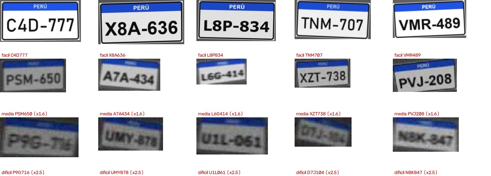
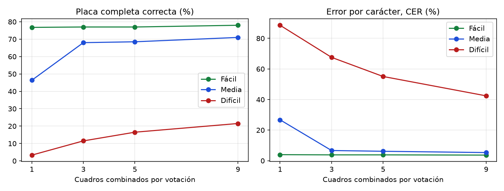
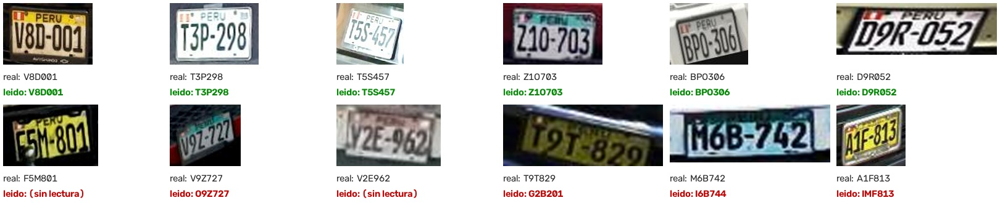

# 06 · Lectura de placas (OCR) y votación entre cuadros

## Objetivo
Medir cuánto acierta EasyOCR al leer placas peruanas, qué aporta cada paso del procesamiento y cuánto mejora la lectura al **votar entre varios cuadros** de la misma placa (como ocurre en un video).

## Qué se evaluó
Variantes acumulativas (cada una agrega un paso a la anterior):

| Variante | Qué hace |
|---|---|
| Crudo | EasyOCR sobre el recorte de la placa; solo se limpia el texto (mayúsculas, sin "PERÚ") |
| + Preproceso | Escala de grises, ampliación a 64 px de alto y mejora de contraste local (CLAHE) |
| + Formato | Ajuste al formato de placa de auto: posiciones 1 y 3 son letras y 4–6 son dígitos; corrige confusiones (5→S, 0→O / O→0, S→5, B→8…) |
| **+ Extracción** (elegida) | Usa el **guion** para separar los dos bloques y, si no hay guion, elige la ventana de 6 caracteres que menos correcciones necesita |
| + Zona de texto (descartada) | Además recorta la franja "PERÚ" y los bordes antes de leer |

**Votación:** con varias lecturas de la misma placa, se elige carácter por carácter el más votado, ponderando por la confianza del OCR.

Código: [`percepcion/ocr.py`](../../percepcion/ocr.py) · 28 pruebas automáticas en [`tests/test_ocr_texto.py`](../../tests/test_ocr_texto.py)

---

## Parte A · Placas sintéticas (texto conocido)

### Configuración
| Elemento | Valor |
|---|---|
| Generador | [`percepcion/datos/placas_sinteticas.py`](../../percepcion/datos/placas_sinteticas.py) |
| Formatos | 70 % letra-dígito-letra (`V8D-001`) y 30 % tres letras (`ABC-123`) |
| Fuentes | Bahnschrift, Arial Bold, Verdana Bold |
| Placas | 200 por nivel (600 en total), semilla 7 |
| Cuadros por placa | 9, degradados de forma independiente |
| Lecturas de OCR | 16 200 en 264 s (RTX 5070) |

| Nivel | Ancho de la placa | Degradación |
|---|---|---|
| Fácil | 160–220 px | Rotación ±3°, desenfoque leve |
| Media | 70–110 px | Rotación ±8°, perspectiva, desenfoque, movimiento, luz 60–100 %, JPEG 60 |
| Difícil | 55–80 px | Rotación ±12°, más desenfoque y movimiento, luz 45–70 %, JPEG 45 |



*Ejemplos por nivel (media y difícil ampliados para verlos). Una primera versión del nivel difícil (40–60 px, luz 30–60 %) resultó ilegible incluso para una persona y se recalibró.*

### Resultados (variante elegida: + Extracción)

| Nivel | Cuadros | Placa correcta | CER |
|---|---|---|---|
| Fácil | 1 | 76.8 % | 4.0 % |
| | 9 | 78.0 % | 3.7 % |
| **Media** | **1** | **46.4 %** | **26.8 %** |
| | 3 | 68.0 % | 6.7 % |
| | 5 | 68.5 % | 6.2 % |
| | **9** | **71.0 %** | **5.3 %** |
| Difícil | 1 | 3.3 % | 88.6 % |
| | 9 | 21.5 % | 42.4 % |



### Aporte de cada paso (nivel medio)

| Variante | 1 cuadro: correcta / CER | 9 cuadros: correcta / CER |
|---|---|---|
| Crudo | 36.6 % / 24.0 % | 67.5 % / 6.5 % |
| + Preproceso | 39.9 % / 22.5 % | 65.5 % / 6.9 % |
| + Formato | 44.1 % / 28.9 % | 70.0 % / 5.6 % |
| **+ Extracción** | **46.4 % / 26.8 %** | **71.0 % / 5.3 %** |
| + Zona de texto | 45.3 % / 27.9 % | 73.0 % / 4.7 % |

*El CER con 1 cuadro sube al aplicar el formato porque las lecturas que no se pueden llevar al formato se descartan (cuentan como error total). Con votación esas lecturas vacías dejan de pesar.*

### Hallazgos
1. **La votación es el factor más importante en calidad media:** de 46 % a 71 % de placas correctas, y el CER cae de 27 % a 5 %. Ya con 3 cuadros se obtiene casi todo el beneficio.
2. **En calidad fácil la votación casi no ayuda** (77 % → 78 %): los errores restantes son **sistemáticos**, se repiten igual en todos los cuadros. Las confusiones más frecuentes fueron 0→O (269 veces), 5→S (259), 1→I (108) y 7→Z (68).
3. **Casi todos esos errores están en la posición 2** (`V0W` frente a `VOW`, `M5C` frente a `MSC`). Ambos son formatos válidos, así que ninguna regla puede resolverlos sin saber qué letras usan realmente las placas peruanas. No se agregó una regla sin verificar.
4. El ajuste de formato v1 (solo posiciones 4–6) daba 74.5 % en fácil; extenderlo a las posiciones 1 y 3 subió a 78 %. Datos: [`datos/ocr_sintetico_v1_solo_digitos.json`](datos/ocr_sintetico_v1_solo_digitos.json).

---

## Parte B · Placas reales (un solo cuadro)

### Configuración
1. El detector entrenado ([04](04_entrenamiento_detector_yolov8n.md)) se aplicó a las 97 imágenes de prueba con confianza ≥ 0.5 → **171 placas recortadas** (margen de 10 %).
2. Las placas son pequeñas porque el dataset está reducido a 640 × 640: **ancho mediano de 34 px**; solo 68 miden 40 px o más.
3. Se **transcribieron manualmente** las 68 de 40 px o más:

| Categoría | Cantidad | Uso |
|---|---|---|
| Auto, legible | **30** (19 con certeza alta, 11 media) | Evaluación |
| Ilegible (noche, lejos, desenfoque) | 28 | Excluidas |
| Moto (formato `1738-YB`) | 4 | Reportadas aparte |
| Especial (roja o turquesa con letra pequeña a la izquierda) | 6 | Excluidas |

**Convención de transcripción:** en la tipografía de las placas peruanas la `O` y el `0` son casi idénticos. Se transcribieron según la posición (1 y 3 letra, 4–6 dígito); si la ambigüedad caía en la posición 2, la placa se marcó ilegible.

> **La transcripción la hizo una sola persona** y no fue verificada por otra. Antes de usar estas cifras en el paper, otro integrante debe revisar [`datos/ocr_real_transcripcion.csv`](datos/ocr_real_transcripcion.csv) contra las imágenes en `datasets/ocr_real/recortes/`.

### Resultados (30 placas de auto, 1 cuadro)

| Variante | Placa correcta | CER | Placas de 80 px o más (13): correcta / CER |
|---|---|---|---|
| Crudo | 0.0 % | 70.0 % | 0.0 % / 57.7 % |
| + Preproceso | 3.3 % | 51.7 % | 7.7 % / 43.6 % |
| + Formato | 16.7 % | 67.2 % | 23.1 % / 60.3 % |
| **+ Extracción** | **23.3 %** | **56.1 %** | **38.5 % / 34.6 %** |
| + Zona de texto | 6.7 % ❌ | 65.0 % | 7.7 % / 59.0 % |



*Fila superior: lecturas correctas. Fila inferior: errores en placas de 60 px o más (sin lectura, carácter cambiado, borde leído como letra).*

### Análisis de errores (lecturas brutas)
| Lectura de EasyOCR | Placa real | Causa | ¿Se corrigió? |
|---|---|---|---|
| `IBPO306`, `ICHO-Q02` | BPO306, CHO002 | Borde izquierdo del marco leído como "I" | Sí (extracción) |
| `T5S-4571PER` | T5S457 | Restos de la franja "PERÚ" | Sí (extracción) |
| `T3P-2981` | T3P298 | Carácter extra al final | Sí (guion como ancla) |
| `BFE-1624` | BFE469 | Se leen caracteres de más dentro del bloque | No |
| `628201`, `IMF-813` | T9T829, A1F813 | Tipografía alta y angosta: 9↔2, 1↔I, A↔M | No |
| `F8`, `962` | F5M801, V2E962 | Lectura incompleta | No |

**¿Por qué no se usó el recorte de zona de texto?** Mejoraba algo en el sintético, pero en las placas reales bajó la exactitud de 23.3 % a 6.7 %. La caja del detector no siempre está igual de centrada sobre la placa, y al quitar la franja se cortaba también la parte superior de los caracteres (`V8D-O01` pasó a `VBD-QQI`).

### Placas de moto
El formato de moto (`1738-YB`) no está soportado: el ajuste de formato las rechaza. EasyOCR sí leyó bien una (`1946-LC`), lo que indica que bastaría con agregar ese formato.

---

## Conclusiones
1. **Sintético frente a real:** con un cuadro, la variante elegida acierta 77 % (fácil) y 46 % (media) en sintético, pero **23 % en placas reales**. Las sintéticas no reproducen la **tipografía real** (alta y angosta), los marcos, la suciedad ni los reflejos. El sintético sirve para estudiar la votación, **no para estimar el desempeño real**.
2. **La votación entre cuadros es el aporte más claro** del pipeline: en calidad media lleva la exactitud de 46 % a 71 %. En placas reales no se pudo medir porque el dataset tiene fotos sueltas, no video.
3. **El tamaño de la placa importa mucho:** con 80 px o más, la exactitud real sube a 38.5 %. Las cámaras del sistema deben capturar la placa con al menos ~80 px de ancho.
4. **EasyOCR genérico es el cuello de botella.** El siguiente paso con mayor impacto es entrenar o ajustar un OCR con placas peruanas reales (tipografía oficial).

## Limitaciones
- **30 placas reales** es una muestra pequeña: un acierto más o menos cambia la exactitud en 3.3 puntos.
- **Sesgo optimista en la parte real:** las mejoras de extracción se diseñaron mirando los errores de estas mismas 30 placas. El experimento sintético (independiente) confirma que no empeoran, pero el 23.3 % real puede estar algo inflado.
- Transcripción hecha por una sola persona.
- Solo se cubre el formato de placa de auto.

## Cómo reproducir
```bash
pytest tests/test_ocr_texto.py
python -m evaluacion.evaluar_ocr_sintetico --placas 200   # ~4.5 min
python -m evaluacion.recortar_placas_reales               # 171 recortes en datasets/ocr_real/recortes
python -m evaluacion.evaluar_ocr_real                     # usa ocr_real_transcripcion.csv
```
Datos: [`datos/ocr_sintetico.json`](datos/ocr_sintetico.json) · [`datos/ocr_real.json`](datos/ocr_real.json) · [`datos/ocr_real_transcripcion.csv`](datos/ocr_real_transcripcion.csv)
