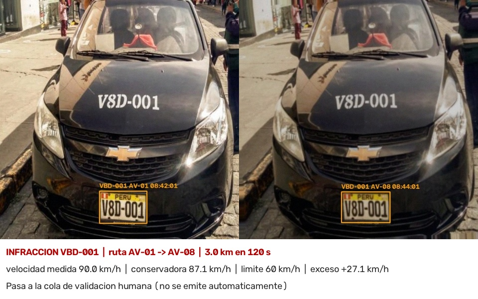

# 07 · Pipeline de punta a punta

## Objetivo
Comprobar que todas las piezas funcionan juntas: **cuadros de cámara → detección de placa → seguimiento → OCR con votación → evento → búsqueda en el grafo → decisión** (infracción, sin infracción o alerta).

## Qué se construyó

| Pieza | Archivo | Función |
|---|---|---|
| Pipeline por cámara | [`percepcion/pipeline.py`](../../percepcion/pipeline.py) | Detecta placas en cada cuadro, las **sigue** entre cuadros (solapamiento de cajas ≥ 0.3), acumula lecturas y, cuando la placa deja de verse, **vota** y emite un evento con el formato de la arquitectura (placa, cámara, hora, confianza, evidencia) |
| Motor de decisión | `motor()` en [`demo/demo_extremo_a_extremo.py`](../../demo/demo_extremo_a_extremo.py) | Lo que hará la web al recibir cada evento: busca capturas previas de la misma placa con `grafo.capturas_coherentes`, calcula `grafo.velocidad_por_tramo` y detecta capturas físicamente imposibles |
| Demo | [`demo/demo_extremo_a_extremo.py`](../../demo/demo_extremo_a_extremo.py) | Simula tres autos pasando por las cámaras y genera reporte, eventos y evidencias |
| Pruebas | [`tests/test_pipeline.py`](../../tests/test_pipeline.py) | 5 pruebas de seguimiento, votación y emisión con detector y lector falsos (sin GPU) |

## Cómo se simularon las cámaras
**No hay video propio todavía**, así que cada "pasada" de un auto por una cámara se simuló a partir de una **foto real** del conjunto de prueba:
- 8 cuadros a 5 fps con **acercamiento progresivo** hacia la placa (el auto se acerca).
- Temblor de ±6 px, desenfoque aleatorio y ruido.
- Un aspecto distinto por cámara: AV-08 con 80 % de luz y 3° de giro; AV-12 con 90 % de luz y −2°.
- La posición de la placa para el acercamiento se toma de la **etiqueta del dataset**, no del detector, para no favorecer al sistema.

Todo lo demás es el sistema real: el detector entrenado ([04](04_entrenamiento_detector_yolov8n.md)), el OCR con extracción y votación ([06](06_ocr_placas.md)) y el paquete `grafo/` ([01](01_modulo_grafo.md)).

## Escenarios

| Auto (placa real) | Recorrido | Resultado esperado |
|---|---|---|
| V8D-001 | AV-01 08:42:00 → AV-08 08:44:00 (3.0 km, 120 s) | Infracción |
| D9R-052 | AV-01 08:43:10 → AV-08 08:46:30 (3.0 km, 200 s) | Sin infracción |
| T3P-298 | AV-01 08:45:00 → AV-12 08:46:00 (6.8 km en 1 min: exigiría 408 km/h) | Alerta: captura imposible |

## Resultado final

**48 cuadros procesados, entre 24 y 32 ms por cuadro** según la ejecución (detector + OCR, RTX 5070): de 30 a 40 cuadros por segundo con una sola GPU.

| Evento | Cámara | Hora | Placa votada | Lecturas por cuadro | Votadas |
|---|---|---|---|---|---|
| EV-…001 | AV-01 | 08:42:01 | **VBD-001** | V8D001 VBD001 VBD001 VBD001 VBD001 V8D001 VBD001 VBD001 | 8/8 |
| EV-…002 | AV-08 | 08:44:01 | **VBD-001** | VBD001 – VBD001 V8D001 – VBD001 VBD001 VBD001 | 6/8 |
| EV-…003 | AV-01 | 08:43:11 | **D9R-052** | DOR052 DOR052 DOR052 D9R052 D9R052 I9R052 D9R052 DOR052 | 8/8 |
| EV-…004 | AV-08 | 08:46:31 | **DOR-052** | DOR052 DOR052 I2R052 DOR052 DOR052 DOR052 DOR052 DOR052 | 8/8 |
| EV-…005 | AV-01 | 08:45:01 | **T3P-298** | TZP298 TSP298 T3P298 T3P298 T3P298 T3P298 T3P298 T3P298 | 8/8 |
| EV-…006 | AV-12 | 08:46:01 | **T3P-298** | T3P298 ×8 | 8/8 |

**Decisiones del motor:**

| Placa | Vínculo | Cálculo | Decisión | ¿Correcta? |
|---|---|---|---|---|
| VBD-001 (real V8D-001) | Confirmado (misma lectura en ambas cámaras) | 3.0 km en 120 s → 87.1 km/h conservadora, exceso +27.1 | **Infracción → validación humana** | Decisión sí; **placa mal leída** |
| D9R-052 / DOR-052 | **A verificar** (difieren en 1 carácter) | 3.0 km en 200 s → 52.9 km/h | Sin infracción | Sí |
| T3P-298 | — | 6.8 km en 1.0 min: exigiría 408 km/h (máximo plausible 200) | **Alerta**: posible placa clonada o error de lectura | Sí |



*Panel de evidencia generado automáticamente: las dos capturas con la placa marcada, la ruta mínima y el cálculo. La placa real es **V8D-001** y el sistema leyó **VBD-001** (confusión 8↔B en la posición 2, ver [06](06_ocr_placas.md)). Es exactamente el tipo de error que corrige el validador humano antes de emitir la papeleta.*

**Hallazgos:**
1. **La votación funciona:** T3P-298 tuvo 2 cuadros mal leídos (TZP, TSP) y aun así se votó bien. En D9R-052 (AV-01) ganó la lectura correcta pese a 4 lecturas "DOR".
2. **El error sistemático de la posición 2 no se corrige votando** (8↔B, 9↔O): si casi todos los cuadros cometen el mismo error, la votación lo confirma.
3. **El vínculo entre cámaras resiste errores de OCR:** la misma lectura incorrecta en ambas cámaras (VBD) se vincula igual, y una diferencia de 1 carácter (D9R/DOR) queda "a verificar".
4. **El filtro de plausibilidad detecta lo imposible:** la alerta de T3P-298 sirve para detectar placas clonadas.

> **Corrección posterior (16/10/2026, [08](08_backend_django.md)):** el filtro original aceptaba una captura solo si el tiempo era al menos la mitad del tiempo típico del tramo. La prueba en vivo de la API mostró que así un auto a 94.7 km/h en zona de 60 se tomaba como captura imposible en vez de infracción. Ahora se usa una **velocidad máxima plausible de 200 km/h** por la ruta más corta. Las decisiones de esta demo no cambian.
5. 6 pistas se descartaron por no llegar a una lectura válida (placas de otros vehículos al fondo de las fotos, pequeñas o parciales).

## Iteración: la primera ejecución falló

| | V8D-001 | D9R-052 | T3P-298 |
|---|---|---|---|
| Primera ejecución | Votó `J8I-001` (AV-01) y `MRD-001` (AV-08): no se vincularon, **no se detectó la infracción** | `D9R-052` y `DOR-052`: no se vincularon | Alerta correcta |
| Final | Infracción detectada (placa VBD-001 → validación) | Sin infracción, vínculo "a verificar" | Alerta correcta |

**Causas y correcciones:**
1. **Error de la simulación, no del sistema:** el acercamiento iba al centro de la foto y la placa **salía del cuadro**, dejando cuadros sin lectura y lecturas parciales. Se corrigió para que el acercamiento siga a la placa, como ocurre con un auto real que se acerca.
2. **Vínculo demasiado estricto:** `grafo.misma_placa` solo aceptaba diferencias en caracteres confundibles. Se alineó con la arquitectura: **un carácter distinto** también cuenta como "a verificar". Es seguro porque esas coincidencias pasan siempre por el filtro de plausibilidad y por la validación humana. Se agregaron 3 pruebas (un carácter distinto, dos distintos, distinta longitud).

## Limitaciones
- **Video simulado** a partir de fotos: el movimiento real, el desenfoque por velocidad y los cambios de luz de una cámara real no están representados. Pendiente M2.
- **Tres escenarios** muestran que la cadena funciona, pero no son una medición estadística.
- Las tres fotos se eligieron entre las que el OCR lee bien en el experimento [06](06_ocr_placas.md); con placas más pequeñas o nocturnas el resultado sería peor.
- El motor de decisión está en el script de demo. En el sistema final vivirá en la API de Django (`POST /api/eventos/`).

## Cómo reproducir
```bash
pytest tests/test_pipeline.py
python -m demo.demo_extremo_a_extremo
```
Salida en `demo/salida/` (no se versiona): `reporte.md`, `eventos.json`, `resultado.json`, `infraccion_*.jpg` y `evidencia/`. Copia de los resultados: [`datos/demo/`](datos/demo/).
