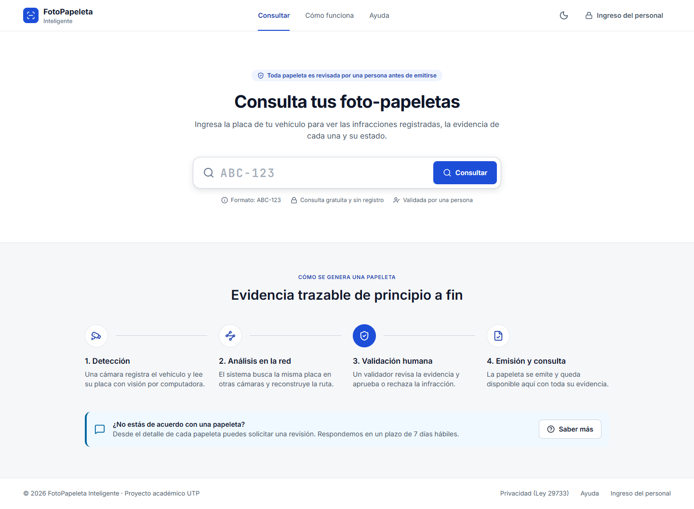
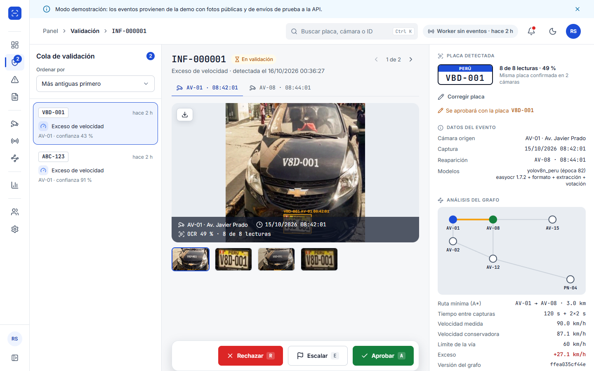
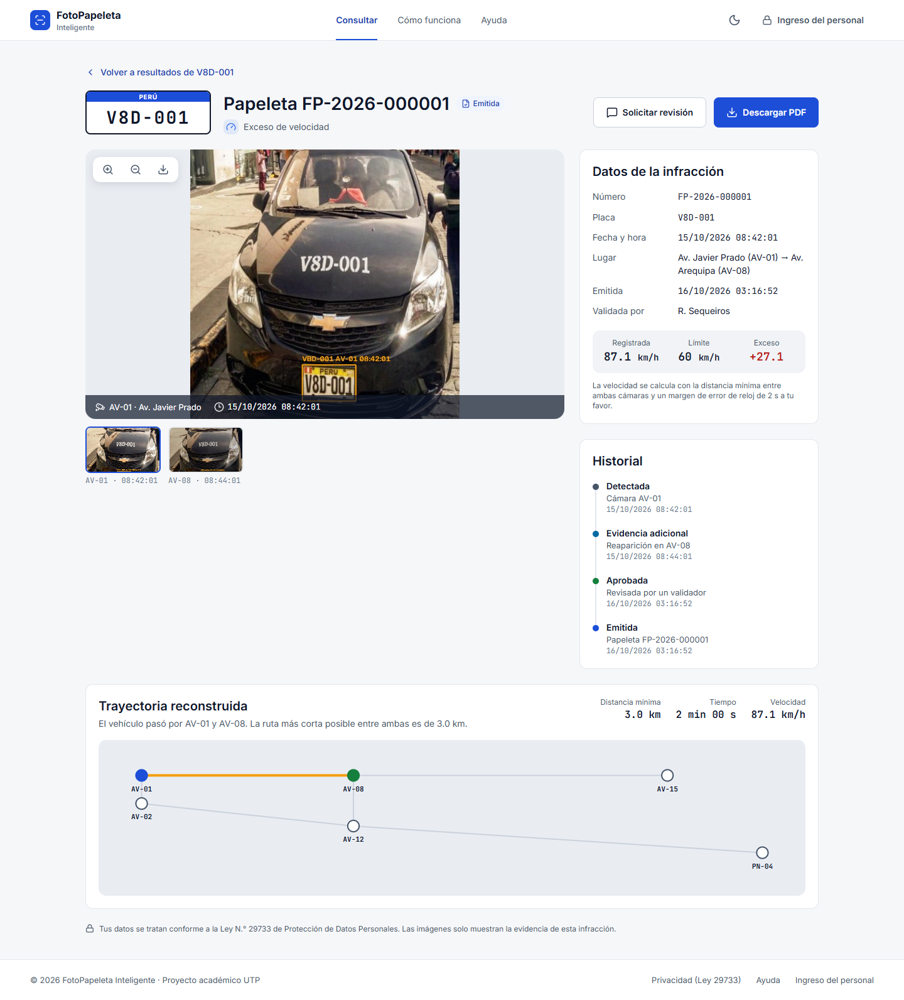
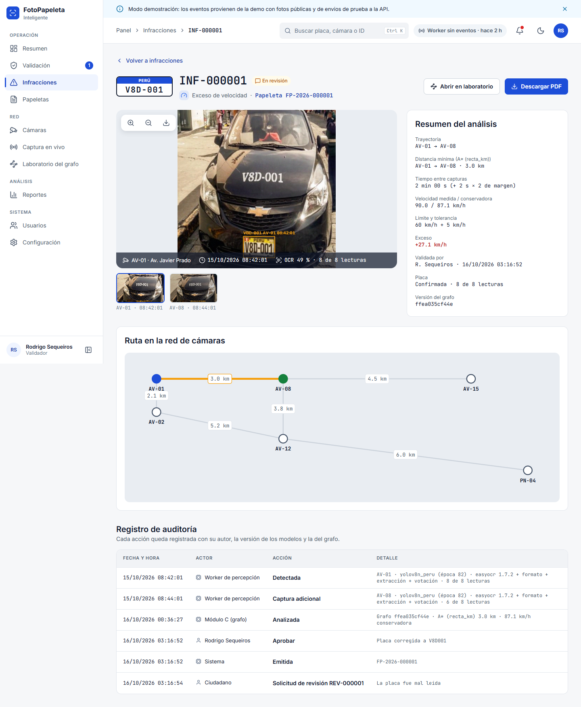
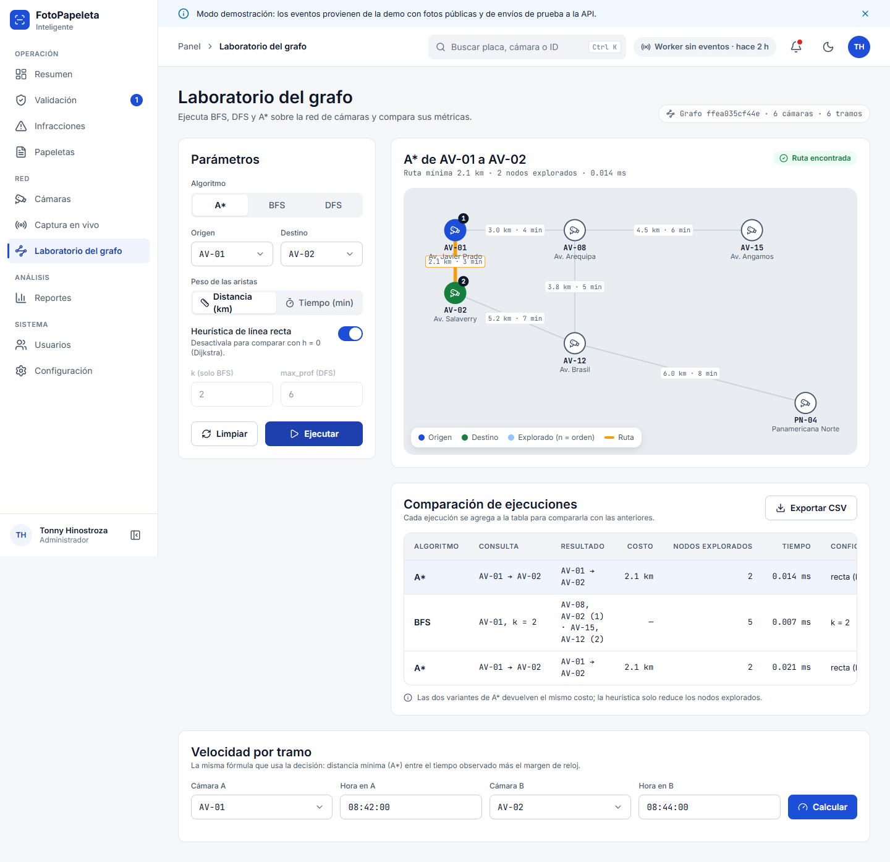
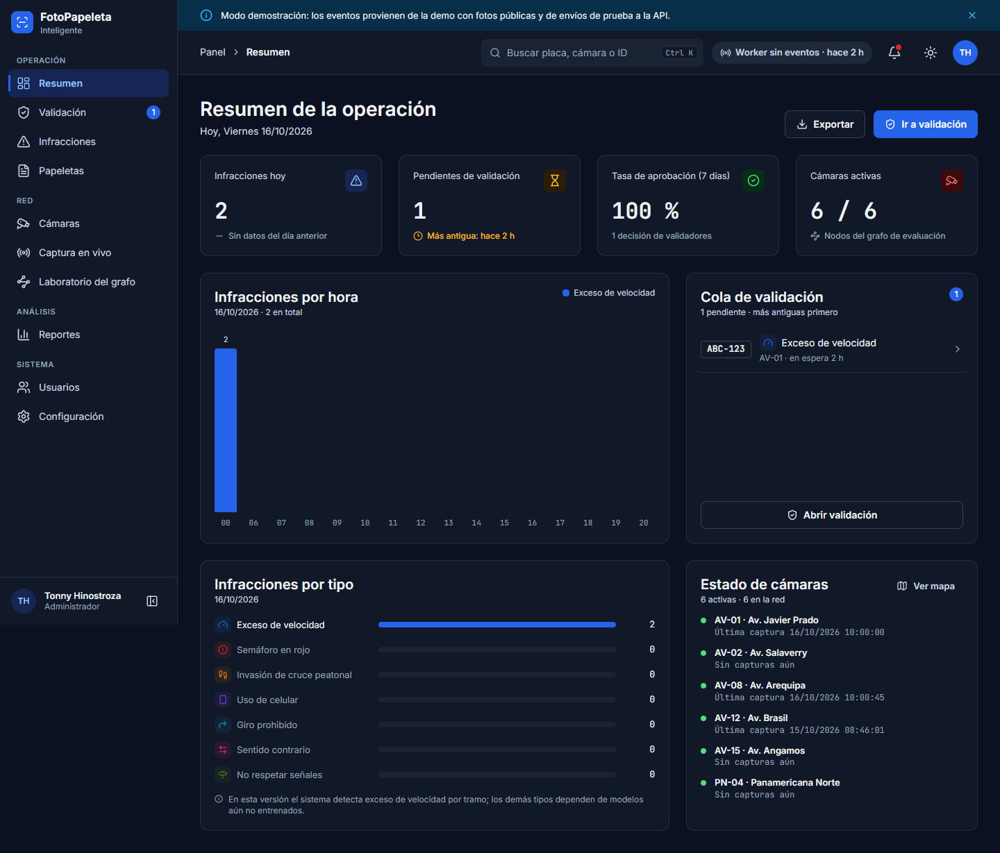

# 09 · Pantallas web (portal ciudadano y panel)

## Objetivo
Pasar el prototipo de pencil.dev (`prototipo/prot.pen`) a pantallas reales en Django, conectadas a la base de datos y al flujo ya probado en [08](08_backend_django.md). Se respetan el sistema de diseño de `prototipo/diseno_prototipo_pencil.md` (colores, tipografía, espaciado, íconos Lucide, sin emojis) y la decisión de frontend: **plantillas Django + Tailwind v4 + HTMX + Alpine.js**.

## Cómo se construyó

| Pieza | Ubicación | Detalle |
|---|---|---|
| Tokens del diseño | `web/static_src/app.css` | Las variables del documento de diseño (`--color-primary`, `--radius-lg`, …) con tema claro y oscuro (`data-theme`) y densidad cómoda o compacta (`data-density`). Nombres idénticos a los de pencil.dev |
| Tailwind v4 | `django-tailwind-cli` 4.8.1 | Ejecutable independiente, **sin Node**: `python manage.py tailwind build`. El CSS compilado (`web/static/css/app.css`) se versiona para correr sin compilar |
| Íconos | paquete `lucide` 1.1.4 | `` genera el SVG en el servidor (sin JavaScript); un script verificó que existan todos los nombres usados (uno, `filter`, no existía y se cambió por `list-filter`) |
| Interacción | HTMX 2.0.4 y Alpine.js 3.14.9 en `web/static/vendor/` | Locales, para que la exposición funcione sin internet. Fuentes Inter y JetBrains Mono también locales |
| Componentes | `web/panel/templatetags/fp.py` y `web/templates/componentes/` | `badge_estado`, `tag_tipo`, `placa_sm`, `placa_grande`, EvidenceViewer, GraphCanvas (SVG generado en el servidor), EmptyState, Banner y Toast |
| Apps | `web/portal/` (público) y `web/panel/` (con sesión) | 8 y 25 rutas |

## Pantallas implementadas

| Código | Pantalla | Ruta | Datos | Interacción |
|---|---|---|---|---|
| P1 | Consulta por placa | `/` | — | Valida el formato de la placa |
| P2 | Resultados | `/resultados/?placa=` | Papeletas de la placa | Filtro por estado; estado vacío |
| P3 | Detalle de papeleta | `/papeleta/<número>/` | Evidencia, velocidad, historial, trayectoria A\* | Visor con zoom; «Descargar PDF» (versión imprimible) |
| P4 | Solicitar revisión | `/papeleta/<número>/revision/` | Crea `SolicitudRevision` | Motivo, descripción, adjunto (JPG/PNG/PDF ≤ 10 MB), correo, declaración; confirmación con código REV |
| — | Cómo funciona, Ayuda, Mis consultas | `/como-funciona/`, `/ayuda/`, `/mis-consultas/` | — | Buscador de preguntas; historial local (no sale del navegador) |
| A0 | Ingreso del personal | `/panel/ingresar/` | — | Usuario **o correo**; mostrar u ocultar contraseña |
| A1 | Resumen | `/panel/` | KPIs, infracciones por hora y tipo, cola, estado de cámaras | Si hoy no hay datos, muestra el último día con registros y lo dice |
| A4 | Validación | `/panel/validacion/` | Cola, evidencia por cámara, lecturas, análisis del grafo | **Aprobar / Rechazar / Escalar** con atajos **A / R / E**; corregir placa; motivo obligatorio; la cola se refresca cada 15 s (HTMX) |
| A3 | Infracciones | `/panel/infracciones/` | Tabla con filtros | Filtros sin recargar (HTMX); chips; selección múltiple con barra flotante; exportar CSV |
| — | Detalle de infracción | `/panel/infracciones/<id>/` | Evidencia, análisis, ruta, **registro de auditoría** | Anular papeleta (solo administrador) |
| — | Papeletas | `/panel/papeletas/` | Pestañas por estado | Copiar enlace público, descargar, anular con motivo |
| A2 | Cámaras | `/panel/camaras/` | Mapa esquemático, detalle y tramos | **Agregar cámara** con su primer tramo; se valida que la red siga siendo válida para A\* |
| — | Captura en vivo | `/panel/captura/` | Estado del worker, última imagen por cámara | Lecturas recientes cada 5 s (HTMX) |
| A8 | Página del celular | `/panel/captura/celular/` | — | Vista previa con la cámara del navegador |
| A5 | Laboratorio del grafo | `/panel/laboratorio/` | Red actual y su versión | BFS, DFS y A\* (con y sin heurística) con orden de exploración; tabla comparativa y CSV; velocidad por tramo |
| A6 | Reportes | `/panel/reportes/` | Operación del periodo + resultados de `evaluacion/resultados` | Hoy / 7 días / mes; imprimir |
| A7 | Configuración | `/panel/configuracion/` | Preferencias y **parámetros del sistema** | Tema, densidad, refresco y atajos; el administrador cambia tolerancia, error de reloj, *k* y velocidad máxima plausible |
| — | Usuarios y roles | `/panel/usuarios/` | Usuarios y permisos reales de cada grupo | — |

Además: búsqueda global con **Ctrl K** (INF-…, FP-…, código de cámara o placa), notificaciones con las alertas de captura imposible, menú de usuario y aviso de «modo demostración».

## Cambios en el backend que pidieron las pantallas

| Cambio | Motivo |
|---|---|
| `ParametrosSistema` (app `panel`) y `panel.models.parametros()` | La pantalla A7 cambia los parámetros de decisión; `registrar_evento` ya no lee `settings.FOTOPAPELETA` directamente |
| Decisión **Escalar** (`Validacion.Decision.ESCALAR`, `Infraccion.escalada`) | Botón «Escalar» del prototipo: la infracción sigue en la cola, marcada para un administrador |
| `validacion.servicios.anular()` y campos de anulación en `Papeleta` | Anular con motivo, autor y fecha (auditoría) |
| `validacion.servicios.solicitar_revision()` | P4: la papeleta y la infracción pasan a «En revisión»; no se aceptan dos solicitudes seguidas |
| `grafo.a_estrella(..., traza=[])` | El laboratorio muestra el orden en que A\* explora los nodos. Parámetro opcional: las 66 pruebas del paquete siguen pasando |
| `crear_roles` incluye la app `panel` | El administrador puede cambiar los parámetros |
| Formatos `config/formatos/es` | Punto decimal (87.1 km/h) y fechas `dd/mm/aaaa`, como pide la sección 13 del diseño (es-pe usa coma por defecto) |

## Pruebas automáticas: 26/26 (`web/panel/tests.py`)

| Grupo | Pruebas |
|---|---|
| Acceso | Las 16 pantallas del panel cargan; sin sesión redirige al ingreso; ingreso con correo; el **worker no entra al panel** (403, pantalla «sin permiso») |
| Validación | La cola muestra el análisis (87.1 km/h, +27.1); aprobar con placa corregida emite la papeleta; rechazar sin comentario no cambia nada; rechazo guarda «motivo: comentario»; escalar deja la infracción en la cola |
| Papeletas y auditoría | Solo el administrador anula (el validador recibe 403); la auditoría reúne detección, captura adicional, análisis, aprobación con placa corregida y emisión |
| Búsqueda y exportación | Filtros, búsqueda global (INF y código de cámara), CSV, marcar alerta como revisada |
| Laboratorio y red | A\* con y sin heurística: **mismo costo (12.8 km) y menos o igual nodos explorados con heurística**; DFS sin ruta; velocidad por tramo (87.1 km/h → infracción; 45 s → captura imposible); **agregar una cámara con un tramo más corto que la línea recta se rechaza** (A\* dejaría de ser exacto); el validador no agrega cámaras |
| Configuración | Subir la velocidad máxima plausible a 250 km/h hace que un caso de 240 km/h pase de alerta a infracción en los eventos nuevos; el validador no cambia parámetros |
| Portal | Páginas públicas; solo se muestran papeletas emitidas; placa inválida; detalle, versión imprimible y 404; revisión: exige la declaración, crea REV-…, cambia los estados y no admite una segunda solicitud |

Total del proyecto: **108/108** (66 de los módulos y 42 de Django: 16 de la API y 26 de las pantallas).

## Prueba en el navegador (Edge, Playwright)

Se recorrió el flujo completo con el servidor real, como lo haría el equipo en la exposición:

1. El validador ingresa con su correo, abre INF-000001 (VBD-001, leída mal por el OCR), corrige la placa a **V8D-001** y aprueba con la tecla **A** → toast «INF-000001 aprobada» y papeleta **FP-2026-000001**.
2. En el portal, la consulta de V8D-001 muestra la papeleta; el detalle presenta la evidencia de AV-01 y AV-08, 87.1 km/h conservadora, el historial y la trayectoria A\*.
3. El ciudadano solicita una revisión → **REV-000001**; la papeleta queda «En revisión».
4. En el panel, la auditoría de INF-000001 registra las 6 acciones (detección, captura adicional, análisis, aprobación con la placa corregida, emisión y la solicitud).

Sin errores de JavaScript en la consola en ninguna pantalla. Capturas en `img/web/`:

| | |
|---|---|
|  |  |
| P1 · Consulta por placa | A4 · Validación con la placa corregida |
|  |  |
| P3 · Detalle de la papeleta emitida | Detalle de la infracción y su auditoría |
|  |  |
| A5 · Laboratorio del grafo | A1 · Resumen en tema oscuro |

Otras: `a1_resumen`, `a2_camaras`, `a3_infracciones`, `a6_reportes`, `a7_configuracion`, `papeletas`, `captura_en_vivo`, `usuarios`, `p2_resultados`, `p4_revision`, `p4_enviada`, y las versiones móviles `*_movil`.

## Problemas encontrados al revisar las capturas

| Problema | Corrección |
|---|---|
| La clase propia `overline` (rótulos en mayúsculas) chocaba con la utilidad `overline` de Tailwind y dibujaba una línea sobre el texto | Renombrada a `rotulo` |
| Con `runserver --noreload` las plantillas quedan en caché y las capturas mostraban la versión anterior | Servidor con recarga automática |
| Django en `es-pe` muestra «0,96» y «81,3», pero el diseño pide punto decimal | Formatos propios en `config/formatos/es` |
| En el laboratorio, un formulario oculto ocupaba una celda de la rejilla y empujaba el resultado a la columna angosta | Formulario fuera de la rejilla |
| Los eventos de prueba con hora futura contaban como «capturas recientes» | Solo cuentan horas entre 0 y 5 minutos atrás |
| La tarjeta de una cámara mostraba la foto de una captura y la placa de otra | Foto y placa salen de la misma captura |
| En la validación la evidencia quedaba angosta con la barra lateral abierta | En esa pantalla la barra lateral arranca colapsada (72 px), como en el prototipo |

## Qué no se implementó y por qué (decisiones honestas)

| Elemento del prototipo | Situación |
|---|---|
| Recuadros de detección sobre la imagen | El worker no envía las coordenadas de la caja; se ven las que la demo dibujó en las fotos |
| «Placas y rostros de terceros difuminados» | No hay difuminado automático; el texto del portal no lo promete (pendiente S7) |
| «Cámara en línea / sin señal» | Las cámaras no envían un latido; se muestra «con capturas en los últimos 5 min» o «desactivada» |
| Mapa con OpenStreetMap | Las cámaras solo tienen coordenadas esquemáticas x/y (pendiente S4); se dibuja el grafo en SVG |
| Página del celular enviando cuadros | Muestra la vista previa; el envío al worker sigue pendiente (S1) |
| Infracciones de semáforo, celular, etc. | El sistema solo detecta exceso de velocidad; los demás tipos se muestran en 0 con una nota |
| Sonido y correo de notificaciones | No se incluyeron en Preferencias para no mostrar opciones que no hacen nada |
| PDF de la papeleta | Versión imprimible: «Guardar como PDF» del navegador |

## Cómo reproducir
```bash
pip install -r requirements-web.txt
cd web
python manage.py migrate
python manage.py crear_roles --worker worker-demo
python manage.py createsuperuser
python manage.py tailwind build      # solo si se cambian clases en las plantillas
python manage.py test                # 42 pruebas
python manage.py runserver 8000      # portal: http://127.0.0.1:8000/   panel: /panel/
```
