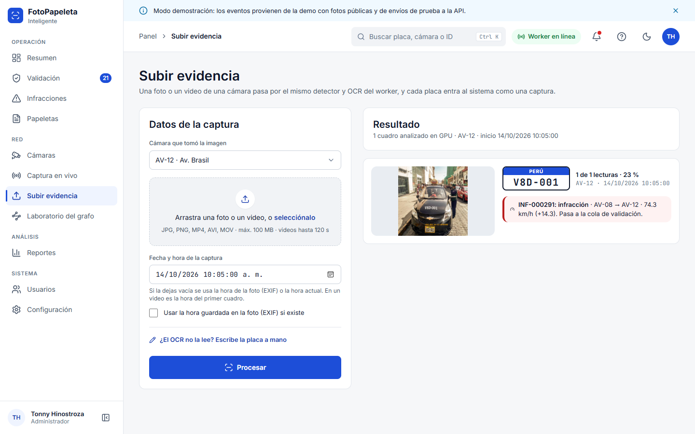
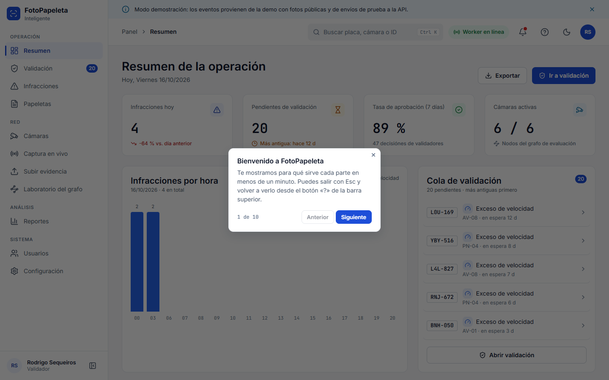
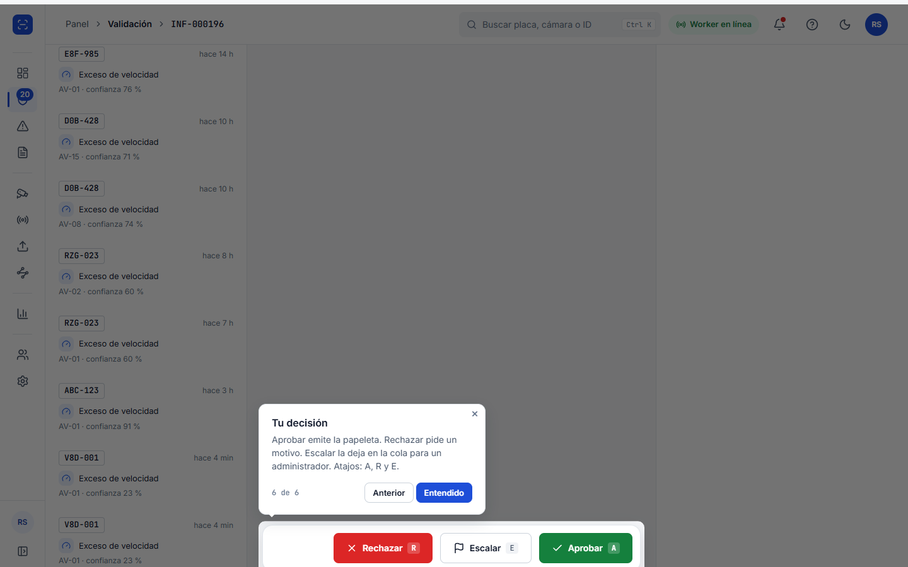

# 10 · Datos de demostración, subir evidencia y guía interactiva

## 1. Datos de demostración (`generar_demo`)

**Objetivo:** tener suficientes casos para probar y exponer el panel (cola, papeletas, reportes) sin inventar resultados. El comando simula **vehículos que recorren la red**; cada paso por una cámara entra por `registrar_evento`, el mismo flujo de la API. **Las infracciones, los tramos sin infracción y las alertas las decide el sistema**, no el comando.

```bash
cd web
python manage.py generar_demo --decidir          # 250 vehículos, últimos 14 días
python manage.py generar_demo --borrar           # quita solo lo simulado (evento_id «SIM-…»)
```

| Opción | Por defecto | Qué hace |
|---|---|---|
| `--vehiculos` | 250 | Cantidad de vehículos simulados |
| `--dias` | 14 | Días hacia atrás desde hoy (nunca en el futuro) |
| `--decidir` | no | Un usuario «Validador demo» (sin contraseña: no puede iniciar sesión) decide las infracciones: ~86 % aprobadas, ~9 % rechazadas con motivo, ~5 % escaladas; las «a verificar» se aprueban corrigiendo la placa o se rechazan |
| `--pendientes` | 12 | Las infracciones más recientes quedan en la cola para validarlas en vivo |
| `--semilla` | 7 | Repetible |
| `--sin-imagenes` | no | No dibuja la evidencia |

**Cómo se simula:** 70 % de los autos a 28–56 km/h, 22 % a 68–112 km/h, 5 % con una lectura de placa equivocada en la última cámara (B↔8, D↔0…) y 3 % de **placas clonadas** (la misma placa en dos cámaras lejanas casi a la vez). Recorren de 1 a 3 tramos de la red, en horas con más tránsito por la mañana y por la tarde, con un error de reloj de ±1.5 s. Las imágenes de evidencia **dicen «EVIDENCIA SIMULADA»**: no se hacen pasar por fotos reales.

**Resultado (semilla 7):** 250 vehículos → 659 pasos por cámaras → **95 infracciones, 313 tramos sin infracción y 4 alertas**, en 7.5 s. Validador demo: 67 papeletas, 11 rechazos, 5 escaladas, 9 solicitudes de revisión; 12 infracciones quedan en la cola. Las fechas automáticas (`creada`, `recibido`, `emitida`) se llevan al momento simulado para que los reportes por día sean correctos.


### Error encontrado al preparar los datos: el mismo recorrido se multaba dos veces
Al revisar la lógica de decisión para simular autos que pasan por **tres** cámaras (A → B → C), se vio que un auto rápido generaba **tres** infracciones: A-B, B-C **y A-C**. A-C repite la distancia ya evaluada en A-B.

**Corrección** (`grafo/decision.py`): cada captura nueva se compara solo con la captura **más cercana en el tiempo** de la misma placa → se evalúan tramos consecutivos (A-B, B-C), como en un control de velocidad por tramos. Prueba de regresión: `tests/test_decision.py::test_regresion_tres_camaras_no_cuenta_dos_veces_el_mismo_recorrido`. En el navegador se comprobó con una foto subida en AV-12 después de AV-01 y AV-08: generó **AV-08 → AV-12 (74.3 km/h)** y no AV-01 → AV-12.

## 2. Subir evidencia (foto o video)

**Pantalla:** Panel → Red → **Subir evidencia** (`/panel/subir/`, rol administrador). Se elige la cámara, la hora y el archivo. El archivo pasa por **el mismo pipeline del worker** (`percepcion/pipeline.py`: YOLOv8 + EasyOCR + extracción + votación) y cada placa encontrada entra con `registrar_evento`.

| | Foto | Video |
|---|---|---|
| Cuadros analizados | 1 | 10 por segundo (máx. 120 s) |
| Lecturas por placa | 1 | Varias: se vota carácter por carácter |
| Hora | La indicada, la del EXIF de la foto o la actual | Hora del primer cuadro + tiempo dentro del video |
| Formatos | JPG, PNG, BMP, WEBP | MP4, AVI, MOV, MKV, WEBM (≤ 100 MB) |

Si el OCR no lee la placa (o no está instalado el entorno de ML), se puede **escribir la placa a mano**: la captura queda marcada «placa escrita por una persona». El archivo original se guarda en `media/subidas/` y su ruta queda en la captura (trazabilidad).

**Pruebas reales (RTX 5070):**

| Prueba | Resultado |
|---|---|
| Foto `peru_billy_00075.jpg` en AV-01 (09:30) y la misma en AV-08 (09:32) | Leyó **V8D-001** (1 lectura, 23 % de confianza) → **INF-000288**: 3.0 km en 120 s, 87.1 km/h, +27.1 |
| Video de 3 s (90 cuadros) armado con `peru_billy_02211.jpg` | 30 cuadros analizados en 5.2 s (con la carga del modelo); **D9R-052 en 28 de 30 lecturas** (con una sola foto, la demo la leía «DOR052») |
| La misma foto en AV-08 subida otra vez | «Esta captura ya estaba registrada»: no duplica la infracción (ver abajo) |



### Error encontrado: la misma foto subida dos veces duplicaba la infracción
Al repetir una subida en las pruebas se crearon INF-000288 e INF-000289 para un solo paso del auto: el sistema solo detectaba duplicados por `evento_id`, y cada subida genera uno nuevo. **Corrección** (`infracciones/servicios.py`): misma cámara + misma placa + misma hora (±1 s) = la misma captura; se responde como duplicado. Sirve también si el worker reenvía un evento con otro identificador. Prueba de regresión: `test_misma_captura_con_otro_id_no_duplica`. La infracción duplicada de la prueba (INF-000289) se borró.

## 3. Guía interactiva (primer ingreso)

La primera vez que una persona entra al panel aparece un **recorrido guiado** (driver.js 1.3.1, licencia MIT, guardado en `static/vendor/`): oscurece la pantalla, resalta cada parte y explica para qué sirve, con «Siguiente / Anterior», «3 de 10» y Esc para salir.

- **Bienvenida + resumen + barra superior** la primera vez; luego **una guía por pantalla** (11 pantallas) la primera vez que se abre cada una.
- Se guarda **en la base de datos por usuario** (`TutorialVisto`): no se repite aunque cambie de computadora.
- El botón **«?»** de la barra superior repite la guía de la pantalla; el menú de usuario permite **«Volver a ver todas las guías»**.
- **Respeta los permisos:** el validador no ve los pasos de «Agregar cámara»; quien no puede validar no ve «Tu decisión».
- Usa los colores y la tipografía del diseño, también en modo oscuro.
- Los textos están en `web/panel/tutorial.py`, separados del código de las plantillas.

| | |
|---|---|
|  |  |
| Primer ingreso | Paso «Tu decisión» en Validación |

**Prueba en el navegador (validador):** bienvenida + 10 pasos en el resumen; al recargar no vuelve a salir; Validación muestra sus 6 pasos; el botón «?» la reabre; sin errores de JavaScript.

## 4. Pruebas automáticas nuevas

| Archivo | Pruebas | Qué cubren |
|---|---|---|
| `tests/test_decision.py` | +1 | Regresión de tres cámaras (sin doble conteo) |
| `web/infracciones/tests.py` | +1 | Misma captura con otro id no duplica |
| `web/panel/tests.py` | +10 | `generar_demo` genera, decide y borra sin tocar datos reales; subir evidencia (dos fotos → infracción, placa a mano, sin entorno de ML, validaciones del formulario, el validador no sube); guía (primera vez y no se repite, permisos, reiniciar, **cada paso apunta a un elemento que existe en su pantalla**) |

La última prueba encontró que la guía de Papeletas apuntaba a una tabla que no existe cuando no hay papeletas; se marcó también el estado vacío.

Total del proyecto: **120/120** (67 de los módulos y 53 de Django). Las pruebas de subida simulan el análisis de ML para no depender de la GPU; la subida real se probó en el navegador (sección 2).

## Limitaciones
- La subida procesa el archivo dentro de la petición web (la primera vez carga los modelos, unos segundos); para muchos videos convendría una cola de trabajos.
- Con una foto la lectura es de un solo cuadro (23 % de acierto en placas reales, [06](06_ocr_placas.md)); conviene subir video.
- Los datos simulados solo incluyen exceso de velocidad, que es lo único que el sistema detecta.
