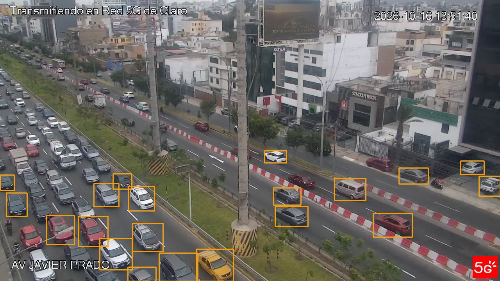
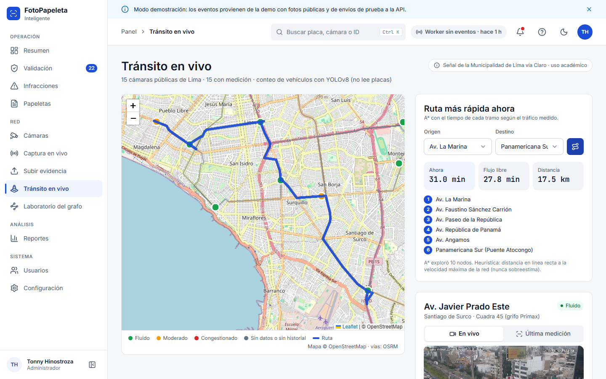
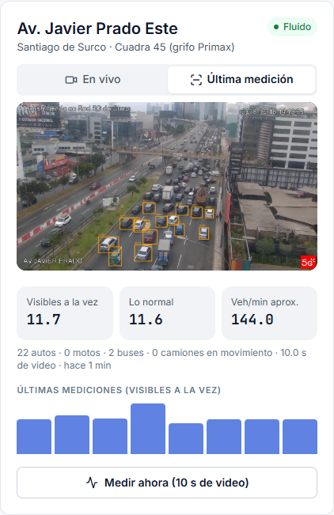

# 11 · Cámaras públicas de tránsito: prueba de factibilidad y módulo «Tránsito en vivo»

## Pregunta
¿Se pueden usar las cámaras de tránsito públicas de Lima (señal de la Municipalidad de Lima transmitida por Claro en claro.com.pe/traficoenvivo) para **leer placas**? Y si no, ¿para qué sirven en el proyecto?

## 1. Prueba de factibilidad (16/10/2026, 13:51)
Se leyeron unos segundos de 6 cámaras (streams HLS `.m3u8`, se abren directo con OpenCV) y se pasaron por YOLOv8n preentrenado en COCO (vehículos) y por nuestro detector de placas.

| Cámara | Resolución | Vehículos detectados (6 cuadros) | Ancho de un vehículo (mediana / máx.) | Placas |
|---|---|---|---|---|
| Av. Javier Prado | 1280×720 | 113 | 70 / 111 px | 2 detecciones, falsos positivos |
| Av. Angamos | 1280×720 | 46 | 57 / 148 px | 0 |
| Paseo de la República | 1280×720 | 56 | 56 / 100 px | 0 |
| Av. del Ejército | 1280×720 | 14 | 52 / 103 px | 0 |
| Peaje Punta Negra | 2560×1440 | 15 | 127 / 443 px | 0 |
| Gallinazos (Panamericana Norte) | 1920×1080 | 43 | 152 / 580 px | 5 (una era el rótulo «Gallinazos») |

**Lectura de placas con unos 20 s de video de cada una** de las dos cámaras más cercanas a la pista (Gallinazos y Escuela PNP, Puente Piedra): 435 detecciones de placas.
- **Escuela PNP:** todas miden entre 16 y 25 px de ancho.
- **Gallinazos:** 41 de 54 miden menos de 40 px; las dos más grandes que se revisaron (53 y 88 px) eran falsos positivos (letreros, carrocería).
- **OCR:** no leyó ninguna. Las placas reales son bloques de píxeles comprimidos, ilegibles también para una persona; el OCR necesita 80 px o más ([06](06_ocr_placas.md)).

**Conclusión:**
- Estas cámaras **no sirven para leer placas**: son de vigilancia general (altas, gran angular, video comprimido), no cámaras lectoras de placas.
- Sí sirven, y muy bien, para **detectar y contar vehículos**: un modelo preentrenado los encuentra sin entrenamiento adicional.

Por eso **la fiscalización sigue con cámaras cercanas a la vía** (celulares en la demo) y estas cámaras alimentan un **módulo aparte**.

## 2. Módulo «Tránsito en vivo» (Panel → Red → Tránsito en vivo)

| Parte | Cómo funciona |
|---|---|
| **Red real** (`data/red_transito.json`) | 15 cámaras con coordenadas de OpenStreetMap (13 de Nominatim, a nivel de vía; 2 aproximadas a mano). 19 tramos por los corredores viales (Panamericana Norte y Sur, Vía Expresa, Javier Prado, Angamos…). **Distancia y tiempo por calle de OSRM** (rutas sobre OpenStreetMap, a flujo libre) y la geometría real de la vía para dibujarla. La red pasa la misma validación `grafo.validar` (recta ≤ tramo) |
| **Medición** (`transito/servicios.py: medir`) | 10 s de video a 10 cuadros por segundo → YOLOv8n (COCO: auto, moto, bus, camión) + **seguimiento ByteTrack**. Mide **vehículos visibles a la vez** (promedio) y **vehículos distintos en movimiento por minuto**: solo cuenta un vehículo seguido en 5 cuadros o más que se desplazó al menos 1/4 de su ancho, para no contar estacionados ni fragmentos del seguimiento. Guarda solo la última imagen anotada por cámara; **no lee ni guarda placas** |
| **Congestión relativa** | Se compara con **lo normal en la misma cámara** (mediana de sus últimas 30 mediciones; hacen falta 5): factor = visibles ahora ÷ lo normal, entre 1 y 3. Fluido < 1.25 · moderado < 1.6 · congestionado ≥ 1.6. Una medición de más de 30 min no cuenta |
| **A\* con tiempos dinámicos** | Peso de cada tramo = minutos a flujo libre × promedio del factor de sus dos cámaras. Heurística = distancia en línea recta ÷ velocidad máxima de la red a flujo libre: **nunca sobreestima**, así que A\* sigue siendo exacto (hay una prueba que lo verifica en todos los tramos) |
| **Pantalla** | Mapa Leaflet + OpenStreetMap con las cámaras coloreadas por congestión; ruta más rápida «ahora» frente a la de flujo libre, dibujada sobre la vía real; **video en vivo** (hls.js) y la última imagen analizada; botón «Medir ahora»; tabla de mediciones |
| **Worker** | `python manage.py monitorear_transito` mide todas las cámaras en ciclos (por defecto cada 2 min). `importar_red_transito` carga la red |

Librerías nuevas, guardadas en `static/vendor` como las anteriores: Leaflet 1.9.4 y hls.js 1.5.17. En Python, `lap` (lo necesita ByteTrack de Ultralytics).

**Prueba en el navegador:**
- El monitor midió las 15 cámaras en 5 rondas sin errores.
- La ruta Av. La Marina → Puente Atocongo sale de **31.0 min ahora frente a 27.8 min a flujo libre** (La Marina y Angamos estaban en «moderado») y se dibuja sobre las calles reales.
- El video en vivo se reproduce en el navegador (1280 px).
- No hubo errores de JavaScript.
- Se corrigió que las capas del mapa tapaban la barra superior.

| | |
|---|---|
|  |  |

**Incidencia (mapa «Access blocked»):** los servidores de OpenStreetMap exigen saber desde qué sitio se piden las imágenes del mapa (cabecera Referer). Django, por seguridad (`Referrer-Policy: same-origin`), no la envía a otros dominios, y OSM respondía 403 «Access blocked».
- **Corrección:** la capa del mapa envía solo el origen del sitio (`referrerPolicy: strict-origin-when-cross-origin`). Verificado en Edge: 12 de 12 imágenes cargadas en tema claro y oscuro.
- Se probó CARTO como alternativa, pero ahora exige una clave de API.
- En tema oscuro, las imágenes del mapa se invierten con un filtro CSS.

## 3. Calibración del conteo (honestidad)
| Ajuste | Javier Prado | Angamos | Punta Negra |
|---|---|---|---|
| Todos los id del seguimiento (conf 0.3) | 360/min | — | — |
| Solo vehículos en movimiento (conf 0.3, ≥ 3 cuadros) | 150/min | 157/min | 90/min |
| Conf 0.4, ≥ 5 cuadros (**usado**) | 180/min | 8/min | 32/min |

La tasa por minuto **depende mucho de los umbrales** del seguimiento con vehículos pequeños y **no se validó contra un conteo manual**: en la pantalla se muestra como «aprox.».

Por eso la congestión usa la medida estable: **vehículos visibles a la vez**, comparada con lo normal de la misma cámara.

## 4. Pruebas automáticas (`web/transito/tests.py`, 8)
- La red real es válida y conexa.
- La congestión se mide relativa a cada cámara; una medición vieja no cuenta.
- A\* nunca da menos que el tiempo a flujo libre.
- **La heurística es admisible en los 38 arcos de la red.**
- La pantalla y la ruta funcionan; un stream caído muestra el error; sin sesión no se entra.
- La prueba de la guía interactiva incluye esta pantalla.

## Aspecto legal
La señal es pública y la emite la Municipalidad de Lima. El uso es académico: contar vehículos, sin guardar video, placas ni rostros (solo la última imagen anotada de cada cámara). Fiscalizar con estas cámaras o retransmitirlas requeriría permiso de la Municipalidad y cumplir la Ley N.° 29733.

## Limitaciones
- El conteo por minuto no está validado con un conteo manual. **Pendiente T1:** contar a mano 1 minuto en 3 cámaras y ajustar los umbrales.
- «Lo normal» necesita varios días de mediciones a distintas horas; con pocas mediciones casi todo sale «fluido».
- Las coordenadas son de la vía, no de la cuadra exacta; los tiempos de OSRM son a flujo libre.
- El stream llega con unos segundos de retraso.
- El factor de congestión es una estimación a partir de la cantidad de vehículos visibles, no una velocidad medida.
