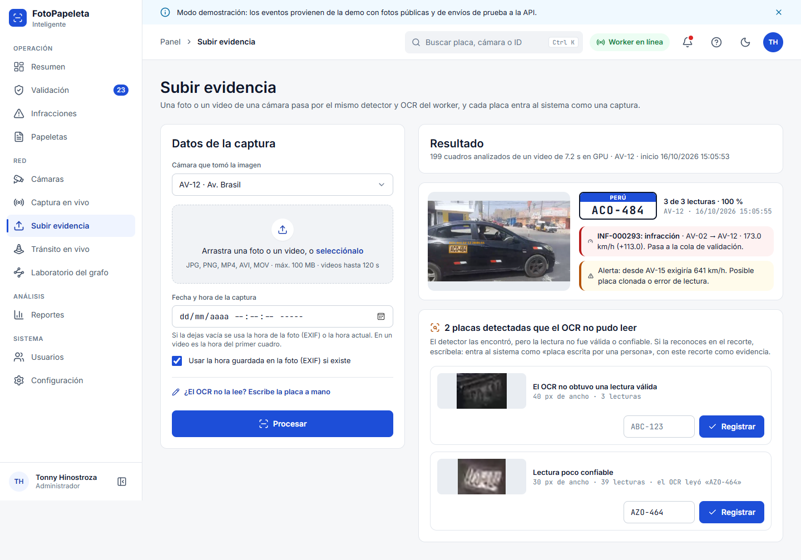

# 12 · OCR especializado en placas (fast-plate-ocr)

## Motivo
EasyOCR genérico era el cuello de botella del sistema: **23.3 %** de acierto en placas reales con un solo cuadro ([06](06_ocr_placas.md)). Con un video real grabado con celular (un taxi), **no leyó nada**: ni la placa trasera (11–46 px) ni el número pintado en la puerta, que se veía nítido a 101 px («ACO-484»). Solo devolvió fragmentos: «CO», «00», «WOB»; con otros preprocesados, en el mejor caso «AC0AB».

## Qué se probó
[fast-plate-ocr](https://github.com/ankandrew/fast-plate-ocr) 1.1.0 (licencia MIT): modelos ONNX **entrenados específicamente para leer placas** de muchos países. **Perú no está entre sus regiones de entrenamiento**, así que no pudo haber visto nuestras imágenes de prueba. Se probaron 3 modelos sobre **las mismas 30 placas reales transcritas a mano** de la prueba 06, con y sin nuestras reglas del formato peruano (`extraer_placa`).

Script: `python -m evaluacion.comparar_ocr_placas` → `evaluacion/resultados/ocr_comparacion.json`.

| OCR | Exactitud (30 placas) | CER | Placas ≥ 80 px (13) | Tiempo por placa |
|---|---|---|---|---|
| EasyOCR + preproceso + reglas (antes) | 23.3 % | 56.1 % | 38.5 % | 38.8 ms (GPU) |
| fast-plate-ocr `global-plates-mobile-vit-v2` + reglas | 53.3 % | 11.1 % | 61.5 % | 6.2 ms (CPU) |
| fast-plate-ocr `cct-s-v2-global` + reglas | 76.7 % | 6.7 % | 76.9 % | 15.1 ms (CPU) |
| **fast-plate-ocr `cct-xs-v2-global` + reglas** | **86.7 %** | **7.2 %** | **92.3 %** | **3.3 ms (CPU)** |
| `cct-xs-v2-global` solo, sin reglas | 83.3 % | 5.6 % | 92.3 % | — |

- **Placas pequeñas:** lee placas de 44–57 px que EasyOCR no leía (T1A093, A6G729, D9M958, A2W767, APU293…).
- **Reglas del formato peruano:** suman 3 puntos (de 83.3 % a 86.7 %). Corrigen confusiones como Z1O703 → Z10703 cuando la posición exige un dígito, y V80842 → V8O842 cuando exige una letra.
- **Errores restantes (4 de 30):** dos placas de 40–44 px leídas casi por completo mal (T7C417, T5D655), una de 43 px (T6J611) y una de 103 px con V↔Y (A4V293 → A4Y293).

### Casos de las pruebas del usuario
| Recorte | EasyOCR | fast-plate-ocr |
|---|---|---|
| Puerta del taxi, 111 / 101 / 72 px | «C0», «00», «CO» | **ACO484** (confianza 1.00) |
| Placa trasera del taxi, 46 px | — | KCO484 (1 carácter mal) |
| CFU-429 trasera, foto inclinada, 112 px | EFO422 (11 %) | **CFU429** (1.00) |
| CFU-429 delantera, 272 px | CFU429 (94 %) | **CFU429** (1.00) |

## Integración
- **`percepcion/ocr.py`:** `LectorPlacas(motor="auto")` usa fast-plate-ocr `cct-xs-v2-global` si está instalado y EasyOCR si no. Luego aplica las mismas reglas de formato y la votación entre cuadros. El worker, «Subir evidencia» y el pipeline lo usan sin cambios.
- **Resultados históricos:** las evaluaciones anteriores y la demo del paper ([06](06_ocr_placas.md), [07](07_pipeline_extremo_a_extremo.md)) fijan `motor="easyocr"`, para que sus resultados sigan siendo reproducibles.
- **Instalación sin dependencias:** `pip install --no-deps fast-plate-ocr==1.1.0 onnxruntime`. Sin `--no-deps` instalaría `opencv-python-headless`, que choca con el OpenCV del proyecto.

## Problemas del pipeline encontrados con el video del taxi
| Problema | Corrección | Prueba |
|---|---|---|
| A 10 cuadros por segundo, un auto que pasa de costado se mueve tanto entre cuadros que el seguimiento (IoU ≥ 0.3) lo pierde: cada detección quedaba como una pista suelta y se descartaba | «Subir evidencia» analiza **30 cuadros por segundo** (con el OCR nuevo, el video de 7 s tarda unos 4 s) | Video real |
| Una pista que mezclaba dos objetos votaba una placa sin respaldo («ACO-444», confianza 0.0) | No se emite una placa con confianza < 0.5 | `test_pista_sin_lectura_confiable_no_se_emite` |
| La misma placa salía 3 veces cuando el seguimiento se cortaba y se retomaba | La misma placa en la misma cámara dentro de 5 s es el mismo paso | `test_misma_placa_retomada_no_se_duplica` |

**Resultado con el video del usuario, subido por la pantalla:** 199 cuadros analizados → **un evento: ACO-484, 3 de 3 lecturas, confianza 100 %**. Antes: «No se encontró ninguna placa legible».

## Placas detectadas que el OCR no pudo leer
Antes, si el detector veía una placa pero el OCR no la leía, «Subir evidencia» decía «No se encontró ninguna placa», y no era cierto. Ahora:
- **El pipeline guarda las pistas descartadas** (sin lectura válida, con muy pocas lecturas o con confianza < 0.5) de 25 px o más, con su mejor recorte y el cuadro.
- **La pantalla las muestra** con el recorte ampliado, el motivo, cuántas lecturas tuvo y la sugerencia del OCR si la hubo (el campo viene ya escrito). Una persona escribe o confirma la placa y la registra; entra como «placa escrita por una persona sobre el recorte del detector», con el recorte y el cuadro como evidencia. Un recorte no se puede registrar dos veces.
- **Se filtra el ruido del seguimiento:** se quitan los fragmentos de una placa que sí se registró en el mismo video (la misma lectura a menos de 5 s) y se agrupan las pistas sin lectura a menos de 2 s entre sí (el mismo objeto partido). Con el video del taxi, la lista bajó de 8 recortes (6 eran ACO-484 ya registrada) a **2**: la placa trasera, oscura y de 40 px, y una pista dudosa («AZO-464»).

Pruebas nuevas: `test_placas_no_leidas_se_guardan_para_revision_humana`, `test_fragmentos_de_una_placa_emitida_no_se_piden_a_mano`, `test_pistas_sin_lectura_del_mismo_objeto_se_agrupan` y `test_placa_no_leida_se_escribe_a_mano_desde_su_recorte` (formato inválido, registro con evidencia, sin doble registro, ruta inválida).

**Datos de prueba borrados:** al probar se subió el mismo video en 4 cámaras con la hora actual; el sistema respondió como debía (alertas de placa clonada a 600 y 641 km/h, y una infracción de 173 km/h), pero esos registros (4 capturas, INF-000293 y 2 alertas) se borraron de la base de desarrollo.

## Limitaciones
- 30 placas, transcritas por una sola persona (igual que en la prueba 06).
- El número de la puerta del taxi coincide con la placa (en Perú los taxis lo llevan pintado), pero no es una placa: en un auto particular solo sirven la placa delantera y la trasera.
- El video de WhatsApp llegó comprimido a 848 × 480. Grabar a 1080p o más y pasar el archivo original.
