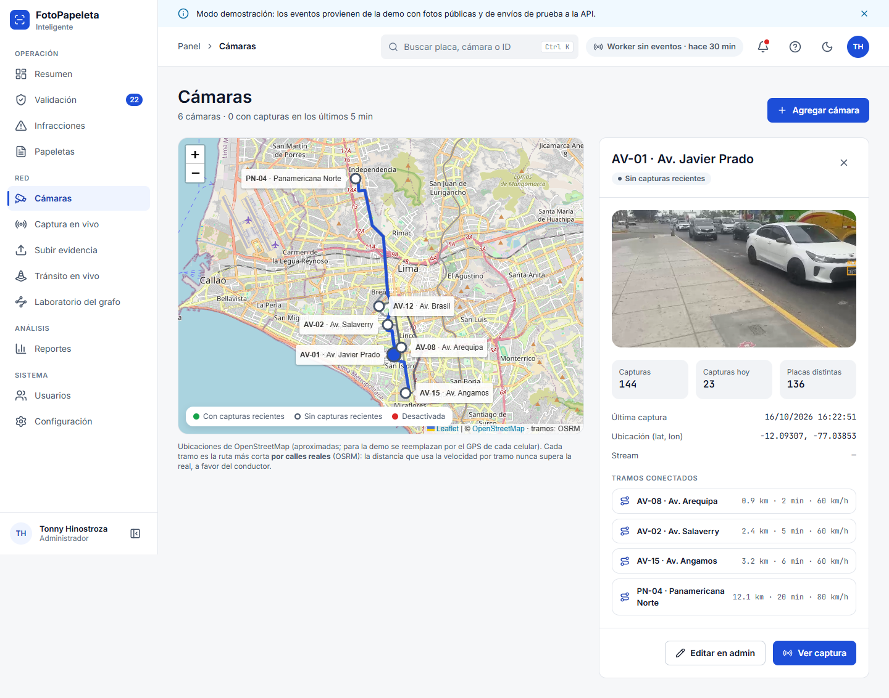

# 13 · Red de fiscalización con ubicaciones y calles reales

## Problema
La red de evaluación (`data/grafo_camaras.json`) tiene nombres reales pero **coordenadas esquemáticas y km escritos a mano**. La velocidad por tramo usa la distancia mínima del grafo, así que:
- si el km está mal, la papeleta está mal;
- si en la ciudad existe un camino más corto que no pasa por ninguna cámara, el grafo usa una distancia **mayor** a la real y calcula una velocidad **más alta** de la posible: **perjudica al conductor**. La validación anterior (recta ≤ tramo) no lo detecta.

## Solución (combinada)
| Pieza | Qué se hizo |
|---|---|
| Ubicaciones | `data/camaras_reales.json`: las 6 cámaras en puntos de OpenStreetMap que corresponden a su nombre (Nominatim). Aproximadas: para la demo se reemplazan por el GPS de cada celular |
| Tramos | `python manage.py calcular_tramos` → `data/grafo_camaras_real.json`. Distancia y tiempo **por calles reales** con OSRM (sentido más corto) y la geometría de la vía |
| Regla 1 | Dos cámaras se unen directamente si la ruta real más corta entre ellas **no pasa por otra cámara** (a menos de 200 m). Así se evalúan tramos consecutivos |
| Regla 2 (a favor del conductor) | Para **cada par** de cámaras: distancia del grafo ≤ distancia real + 50 m. Si un par no cumple, se agrega el tramo directo |
| Cámaras (pantalla) | Mapa real de OpenStreetMap con los tramos dibujados sobre las calles (solo si todas las cámaras tienen lat/lon) |
| Laboratorio | Sigue con el grafo esquemático (SVG), más claro para explicar los algoritmos; con la red real se reparte el dibujo para que se lea, pero las distancias son las reales |
| Red del paper | `data/grafo_camaras.json` no cambia: la Tabla II y el ejemplo de 87.1 km/h siguen reproducibles |

`importar_red` ahora reemplaza la red completa (borra los tramos que ya no están en el archivo). Las infracciones ya decididas conservan su ruta, km y versión del grafo.

## Resultado
15 pares de cámaras consultados → **13 tramos**: 12 por ruta directa y 1 agregado por la regla 2 (AV-01 – PN-04, 12.12 km: sin él, el grafo daba más que la real). **Verificación: en los 15 pares la distancia del grafo es igual a la real (diferencia máxima +0.00 km).**

| Tramo | km reales | Antes (a mano) |
|---|---|---|
| AV-01 – AV-08 | 0.95 | 3.0 |
| AV-02 – AV-12 | 1.63 | 5.2 |
| AV-08 – AV-12 | 3.87 | 3.8 |
| AV-12 – PN-04 | 9.45 | 6.0 |

La diferencia en AV-01 – AV-08 (0.95 frente a 3.0 km) muestra el riesgo: con los km inventados, la misma pareja de capturas daría una velocidad tres veces mayor.



## Pruebas (`web/camaras/tests.py`, 5)
No se une un par cuya ruta pasa por otra cámara · la distancia del grafo nunca supera la real (se agrega el tramo que falta) · distancia punto–ruta · la red real del repositorio es válida, conexa y por calles · importar reemplaza los tramos anteriores.

## Cómo usar
```bash
cd web
python manage.py calcular_tramos                              # tras editar data/camaras_reales.json (GPS de los celulares)
python manage.py importar_red ../data/grafo_camaras_real.json # red real
python manage.py importar_red                                 # volver a la red de evaluación del paper
```

## Limitaciones
- Ubicaciones aproximadas (a nivel de avenida) hasta tener el GPS de cada celular.
- OSRM usa el servidor público de demostración: para calcular la red hace falta internet (una vez).
- «Agregar cámara» del panel sigue pidiendo x/y en km; con la red real conviene editar `camaras_reales.json` y recalcular.
