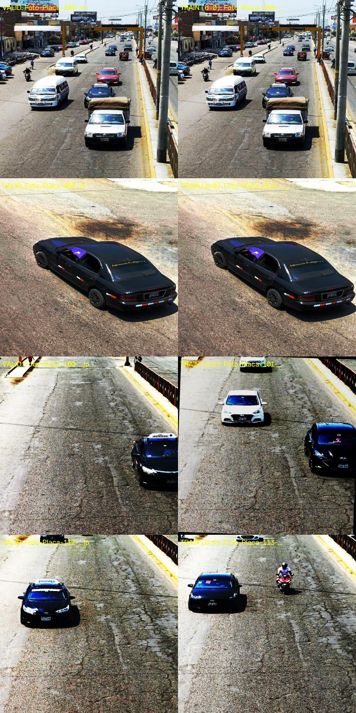
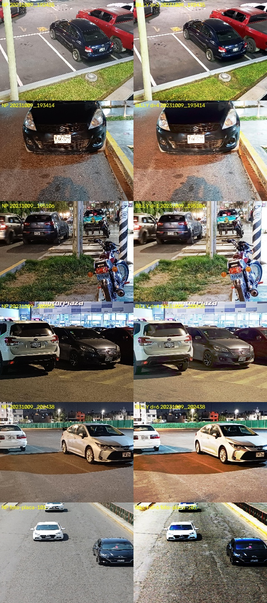
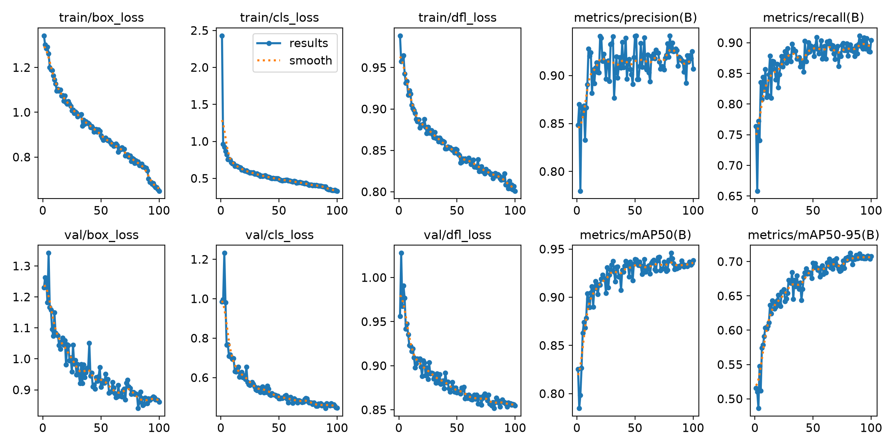
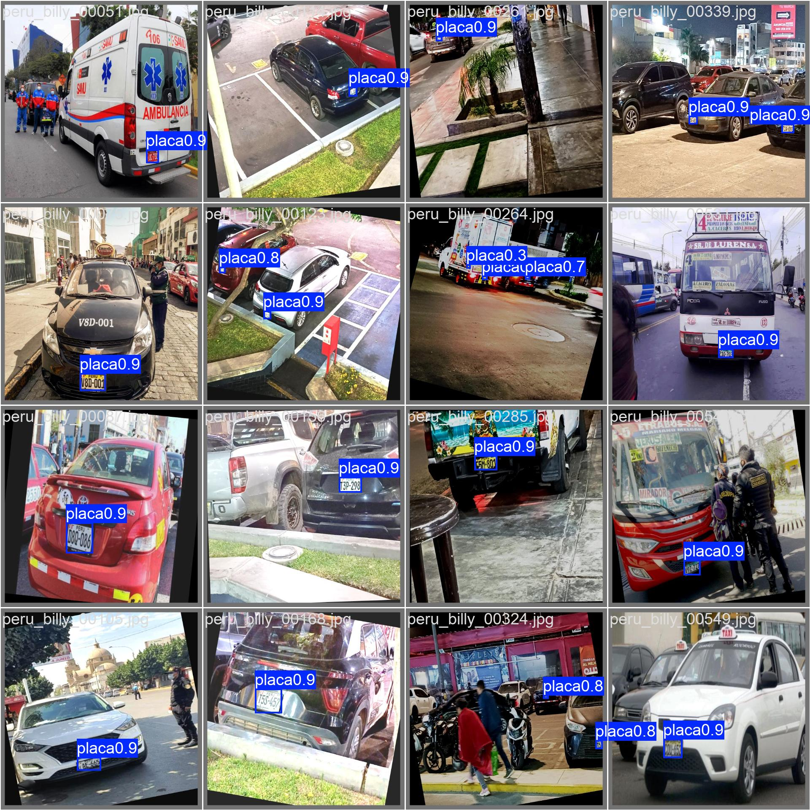
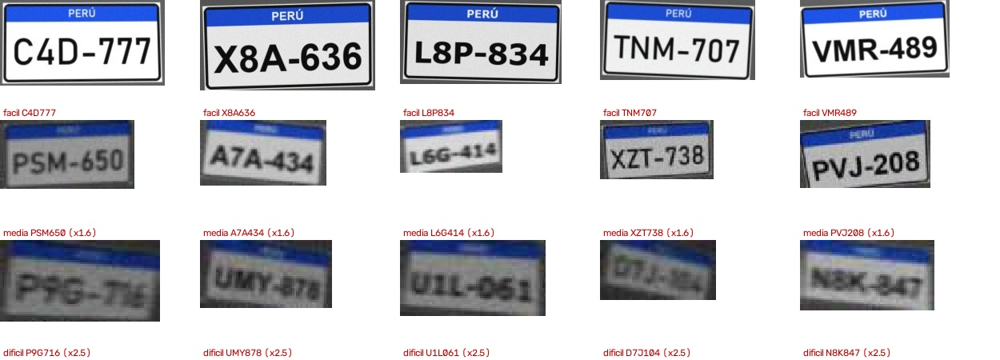
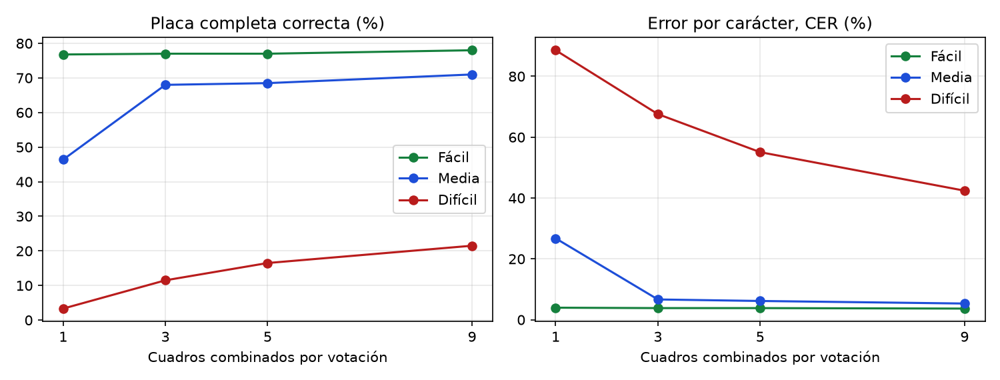
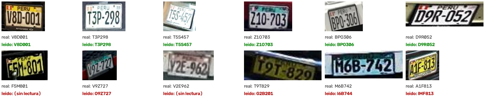
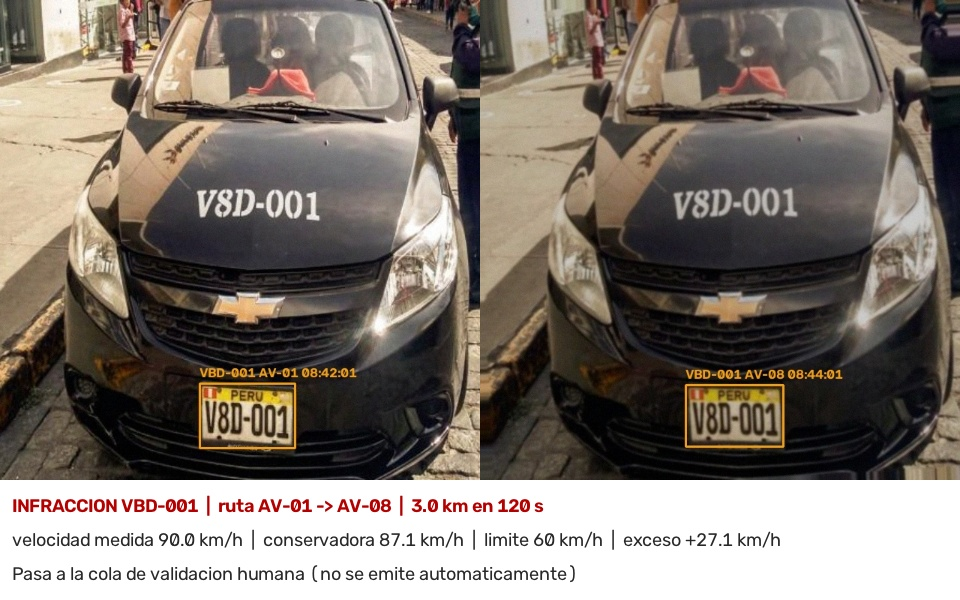

# Informe completo de pruebas — FotoPapeleta Inteligente

**Proyecto:** Hacia una Fiscalización Vial Inteligente: Detección de Infracciones y Seguimiento Vehicular mediante Algoritmos de Búsqueda (APF2 · UTP)
**Fecha:** 15–16/10/2026
**Equipo de cómputo:** AMD Ryzen 5 9600X · 16 GB de RAM · NVIDIA GeForce RTX 5070 (12 GB) · Windows 11
**Software:** Python 3.12.10 · PyTorch 2.11 (CUDA 12.8) · Ultralytics 8.4.177 · EasyOCR 1.7.2 · NetworkX 3.7

Este documento reúne en un solo lugar todas las pruebas realizadas. El detalle de cada una está en los documentos numerados de esta carpeta ([01](01_modulo_grafo.md)–[12](12_ocr_fast_plate_ocr.md)).

---

## 1. Resumen ejecutivo

| # | Prueba | Resultado principal | ¿Va al paper? |
|---|---|---|---|
| 1 | Módulo de grafo (BFS, DFS, A\*, velocidad) | Correcto frente a NetworkX en todos los casos; la heurística reduce 58.5 % los nodos explorados en una red de 400 cámaras | Tabla II, Fig. 2 |
| 2 | Entorno de ML | GPU, YOLOv8 y EasyOCR funcionando | Texto (sección E) |
| 3 | Datos y control de fugas | La división original del dataset tenía fugas; se creó una división propia sin fugas; NumberPlates se descartó por duplicado | Sección C |
| 4 | Detector de placas (YOLOv8n, 100 épocas) | Prueba sin fugas: precisión 95.6 %, exhaustividad 91.3 %, mAP@50 96.5 %, 1.9 ms por imagen | Tabla III |
| 5 | Lectura de placas (OCR) | Votación entre cuadros: 46 % → 71 % (calidad media). Placas reales con 1 cuadro: 23.3 % | Tabla IV |
| 6 | Sistema completo (video simulado) | 3/3 decisiones correctas, 24–32 ms por cuadro; una placa mal leída que corrige la validación humana | Fig. 3 |
| 7 | Backend Django (API, validación, papeletas) | Flujo completo funcionando; la prueba en vivo encontró un error de lógica (autos muy rápidos tratados como placa clonada) que se corrigió | Sección F |
| 8 | Pantallas web (portal y panel) | Las pantallas del prototipo funcionan con datos reales; flujo completo probado en el navegador (corregir placa, aprobar, papeleta, consulta, revisión, auditoría) | Pendiente (Fig. 5 podría mostrar la pantalla real) |
| 9 | Datos de demostración, subir evidencia, guía | 250 vehículos simulados por el flujo real (95 infracciones, 4 alertas); foto y video reales procesados desde el panel; recorrido guiado al primer ingreso | — |
| 10 | Cámaras públicas de tránsito | No sirven para leer placas (16–40 px, 0 lecturas); sí para contar vehículos. Módulo «Tránsito en vivo»: red real de Lima y A* con tiempos según el tráfico | Posible trabajo futuro |
| 11 | OCR especializado en placas (fast-plate-ocr) | **86.7 %** de exactitud en las 30 placas reales (antes 23.3 %), 92.3 % en placas ≥ 80 px, 3.3 ms por placa. Ahora es el OCR por defecto | **Actualizar Tabla IV (P12)** |
| 12 | Pruebas automáticas | **134/134** aprobadas (72 de los módulos y 62 de Django) | Texto (sección E) |

**Conclusión general:** el módulo algorítmico (grafo) y el detector de placas funcionan bien. **El cuello de botella es la lectura del texto de la placa** con un OCR genérico (23 % de acierto real con un solo cuadro); la votación entre cuadros y la validación humana mitigan el problema, pero el siguiente paso con mayor impacto es entrenar un OCR con placas peruanas.

---

## 2. Módulo de grafo
*Detalle: [01_modulo_grafo.md](01_modulo_grafo.md)*

**Red de prueba:** 6 cámaras y 6 tramos de doble sentido, límite de 60 km/h (Tabla I del paper). Referencia independiente: NetworkX 3.7.

| ID | Prueba | Resultado |
|---|---|---|
| P1 | BFS desde AV-01, k = 2 | AV-08 y AV-02 a 1 salto; AV-15 y AV-12 a 2 saltos. Igual a NetworkX |
| P2 | DFS de AV-01 a PN-04 | 2 rutas: 12.8 km y 13.3 km. Igual a NetworkX |
| P3 | A\* en los 30 pares de cámaras | Costo correcto 30/30, por distancia y por tiempo, con y sin heurística |
| P4 | A\* de AV-01 a AV-08 | Ruta directa de 3.0 km; 3 nodos explorados sin heurística y 2 con ella |
| P5 | Velocidad: 3.0 km en 120 s, margen de reloj 2 s | 90.0 km/h medida, 87.1 km/h conservadora, exceso +27.1 → infracción |
| P6 | Velocidad: 3.0 km en 200 s | 52.9 km/h → sin infracción |
| — | Velocidad: 3.0 km en 166 s | 63.5 km/h: supera 60 pero no 60 + 5 de tolerancia → sin infracción |
| P7 | Filtro de plausibilidad AV-01 → AV-12 (6.8 km; máximo 200 km/h) | Captura a 1 min (408 km/h) rechazada; a 10 min (40.8 km/h) aceptada |
| P8 | Coincidencia de placa con ABC-123 | ABC-123 confirmada; A8C-123 y ABC-128 "a verificar"; AXC-128, ABC-1234 y D4F-582 descartadas |
| — | Vía de un solo sentido | Se puede ir pero no volver |
| — | Validación del JSON de la red | Detecta cámaras inexistentes, pesos no positivos y tramos más cortos que la línea recta |
| P9 | Tiempo medio (6 cámaras) | BFS 0.8 µs · DFS 2.9 µs · A\* 3.6 µs sin heurística y 4.7 µs con ella |
| P10 | Escalabilidad: 400 cámaras, 760 tramos, 300 consultas | Costo correcto 300/300; nodos explorados 196.1 → 81.3 (**−58.5 %**); 0.212 → 0.126 ms por consulta |

**Observaciones:** en una red de 6 cámaras la heurística no ahorra tiempo (calcularla cuesta más de lo que ahorra); su ventaja aparece en redes grandes. Los tiempos varían algo entre ejecuciones; los resultados deterministas no.

---

## 3. Entorno de ML
*Detalle: [02_entorno_ml.md](02_entorno_ml.md)*

| Verificación | Resultado |
|---|---|
| PyTorch detecta la GPU | Sí (RTX 5070, CUDA 12.8). Requiere instalar PyTorch desde el índice de CUDA 12.8 |
| Multiplicación de matrices 4096 × 4096 | 7.6 ms |
| YOLOv8n preentrenado sobre imagen de ejemplo | Detecta bus, personas y señal de pare en 7.9 ms |
| EasyOCR sobre placa sintética | Lee "ABC-123" con confianza 1.0 |

---

## 4. Datos y control de fugas
*Detalle: [03_datos_y_control_de_fugas.md](03_datos_y_control_de_fugas.md)*

**Búsqueda:** Hugging Face no tiene ningún dataset de placas peruanas. En Roboflow Universe se eligió **Peru License Plate** (Billy Soplin, 2024): 1 000 fotos de calles de Lima, clase `placa`, licencia CC BY 4.0, versión 9 a 640 × 640 px.

**Auditoría de la división original** (por nombre de origen y por hash perceptual dHash, umbral de 6 bits):

| | Validación (128) | Prueba (53) |
|---|---|---|
| Imágenes casi idénticas a una de entrenamiento | 17 (13 %) | 4 (7.5 %) |



*Arriba: la misma foto subida dos veces, una en validación y otra en entrenamiento. Abajo: autos distintos desde la misma cámara fija (mismo fondo).*

**División propia:** 2 626 imágenes agrupadas en 927 grupos; cada grupo completo va a un solo split (75/15/10 %), con una imagen por grupo en evaluación. Resultado: 1 968 de entrenamiento, 137 de validación y 98 de prueba, con **0 fugas**. Ultralytics descartó 25 imágenes por etiquetas que mezclaban cajas y polígonos, así que la prueba efectiva fue de **97 imágenes y 166 placas**.

**NumberPlates (descartado):** sus 489 fotos de origen están todas en Peru License Plate, solo con otro brillo y contraste.



---

## 5. Detector de placas (YOLOv8n)
*Detalle y tabla de las 100 épocas: [04_entrenamiento_detector_yolov8n.md](04_entrenamiento_detector_yolov8n.md)*

**Configuración:** YOLOv8n preentrenado en COCO, 640 × 640 px, 100 épocas, lote 16, semilla 42, 2 procesos de carga, RTX 5070. Duración: 20 min 33 s. Mejor modelo: época 82.

| Conjunto | Imágenes | Placas | Precisión | Exhaustividad | mAP@50 | mAP@50-95 | ms/imagen |
|---|---|---|---|---|---|---|---|
| Validación | 137 | 237 | 93.4 % | 89.6 % | 94.1 % | 72.0 % | 2.6 |
| **Prueba sin fugas** | **97** | **166** | **95.6 %** | **91.3 %** | **96.5 %** | **75.0 %** | **1.9** |
| Modelo publicado con el dataset (320 × 240, división con fugas) | — | — | 89.7 % | 75.8 % | 85.6 % | — | — |



| Épocas | Qué pasó |
|---|---|
| 1–5 | Ya en la época 1: mAP@50 82.5 % gracias al preentrenamiento |
| 5–30 | Mejora rápida: 86.3 % → 93.4 % |
| 30–80 | Meseta de mAP@50 (92–94 %); las cajas se siguen ajustando (mAP@50-95 de 67 % a 71 %) |
| 90–100 | Sin mosaico: la pérdida de entrenamiento baja, la validación casi no cambia |

**Sin sobreajuste:** la pérdida de validación baja hasta la época ~80 y luego se mantiene.



---

## 6. Lectura de placas (OCR)
*Detalle: [06_ocr_placas.md](06_ocr_placas.md)*

**Variante elegida:** EasyOCR sobre el recorte ampliado y con contraste ecualizado → ajuste al formato de auto (posiciones 1 y 3 letras, 4–6 dígitos) → guion como ancla para separar los bloques → votación entre cuadros ponderada por confianza.

### 6.1 Placas sintéticas (600 placas, 9 cuadros cada una, texto conocido)



| Nivel | 1 cuadro: correcta / CER | 9 cuadros: correcta / CER |
|---|---|---|
| Fácil (160–220 px) | 76.8 % / 4.0 % | 78.0 % / 3.7 % |
| **Media (70–110 px)** | **46.4 % / 26.8 %** | **71.0 % / 5.3 %** |
| Difícil (55–80 px, poca luz) | 3.3 % / 88.6 % | 21.5 % / 42.4 % |



**Por qué la votación no ayuda en el nivel fácil:** los errores que quedan son **sistemáticos** (0→O, 5→S, 1→I, 8→B en la posición 2) y se repiten en todos los cuadros. La posición 2 puede ser letra o dígito en los formatos vigentes, así que ninguna regla puede resolverlos.

### 6.2 Placas reales (1 cuadro)
Se recortaron las 171 placas detectadas en la prueba (ancho mediano de 34 px). Se transcribieron a mano las 68 de 40 px o más: **30 de auto legibles**, 28 ilegibles, 4 de moto y 6 especiales.

| Variante | Correcta (30 placas) | CER | Correcta (13 placas ≥ 80 px) |
|---|---|---|---|
| EasyOCR sin procesar | 0.0 % | 70.0 % | 0.0 % |
| + Preproceso | 3.3 % | 51.7 % | 7.7 % |
| + Formato | 16.7 % | 67.2 % | 23.1 % |
| **+ Extracción por guion (elegida)** | **23.3 %** | **56.1 %** | **38.5 %** |
| + Recorte de la franja superior (descartada) | 6.7 % | 65.0 % | 7.7 % |



**Por qué las sintéticas dan mejor resultado:** la tipografía real de las placas peruanas es alta y angosta, y las placas reales tienen marcos, suciedad y reflejos. Las sintéticas sirven para estudiar la votación, no para estimar el desempeño real.

---

## 7. Sistema completo (video simulado)
*Detalle: [07_pipeline_extremo_a_extremo.md](07_pipeline_extremo_a_extremo.md)*

Cada paso de un auto por una cámara se simuló a partir de una **foto real**: 8 cuadros a 5 fps con acercamiento, temblor, desenfoque y luz distinta por cámara. El resto es el sistema real.

| Placa real | Recorrido | Placa votada | Decisión | ¿Correcta? |
|---|---|---|---|---|
| V8D-001 | AV-01 → AV-08 en 120 s | VBD-001 (ambas cámaras) | **Infracción**: 87.1 km/h, +27.1 → validación humana | Decisión sí; placa mal leída |
| D9R-052 | AV-01 → AV-08 en 200 s | D9R-052 / DOR-052 | Sin infracción (52.9 km/h); vínculo "a verificar" | Sí |
| T3P-298 | AV-01 → AV-12: 6.8 km en 1 min (408 km/h) | T3P-298 | **Alerta**: captura imposible (posible placa clonada) | Sí |

**Rendimiento:** entre 24 y 32 ms por cuadro según la ejecución (detector + OCR): de 30 a 40 cuadros por segundo con una sola GPU.



---

## 7b. Pantallas web
*Detalle: [09_pantallas_web.md](09_pantallas_web.md)*

El prototipo de pencil.dev se pasó a Django con Tailwind v4 (sin Node), HTMX, Alpine.js e íconos Lucide generados en el servidor. Incluye el portal (P1–P4, Cómo funciona, Ayuda, Mis consultas) y el panel (A0–A8, detalle de infracción, papeletas y usuarios), con tema claro y oscuro, versión móvil y los estados vacío, sin permiso y error.

**Flujo probado en el navegador (Edge):** el validador corrige VBD-001 → V8D-001 y aprueba con la tecla A → papeleta FP-2026-000001 → el ciudadano la consulta, ve la evidencia y la trayectoria A\* y pide una revisión (REV-000001) → la auditoría registra las 6 acciones. Sin errores de JavaScript.

**No implementado a propósito:** recuadros de detección (el worker no envía coordenadas), difuminado de terceros, estado «en línea» real de las cámaras (no hay latido), mapa OpenStreetMap (faltan coordenadas reales) y envío de cuadros desde la página del celular.

---

## 8. Pruebas automáticas

| Archivo | Pruebas | Qué cubre |
|---|---|---|
| `tests/test_busqueda.py` | 7 | BFS, DFS, A\*, vías de un sentido |
| `tests/test_velocidad.py` | 4 | Velocidad conservadora, tolerancia, Δt no válido |
| `tests/test_evidencia.py` | 9 | Coincidencia de placas y filtro de plausibilidad |
| `tests/test_decision.py` | 9 | Decisión ante un evento: infracción, sin infracción, alerta (incluye las regresiones del 16/10) |
| `tests/test_modelo.py` | 5 | Validación del JSON de la red |
| `tests/test_ocr_texto.py` | 28 | Normalización, formato, extracción, votación, CER |
| `tests/test_pipeline.py` | 10 | Seguimiento, votación y emisión de eventos (sin GPU), sin lecturas poco confiables ni repetidas; placas no leídas para revisión humana |
| `web/infracciones/tests.py` | 17 | API: eventos, permisos por rol, validación, papeletas, consultas, capturas repetidas |
| `web/panel/tests.py` | 37 | Pantallas: acceso por rol, validación, anulación, auditoría, laboratorio, cámaras, parámetros, portal y revisión; datos de demostración; subir evidencia (incluye placas no leídas); guía interactiva |
| `web/transito/tests.py` | 8 | Red real válida, congestión relativa, A* con tiempos dinámicos y heurística admisible, pantalla |
| **Total** | **134** | **134/134 aprobadas** |

---

## 9. Incidencias principales
*Lista completa: [05_incidencias_y_lecciones.md](05_incidencias_y_lecciones.md)*

| Incidencia | Solución |
|---|---|
| El entrenamiento se colgó sin avisar (WinError 1455: memoria virtual agotada con 4 procesos de carga) | 2 procesos de carga y un monitor por época |
| Rutas de más de 260 caracteres en Windows | Nombres de archivo cortos y un mapa al nombre original |
| 25 imágenes ignoradas por etiquetas mixtas | Detectado en el log; la conversión a cajas ya está en el script de división |
| Fugas en la división original del dataset | División propia por grupos |
| NumberPlates parecía distinto por las miniaturas | Comparación con las imágenes completas |
| El nivel "difícil" del sintético era ilegible para una persona | Recalibrado |
| El recorte de la franja superior empeoró la lectura real | Descartado |
| La primera demo no detectó la infracción | Simulación corregida y vínculo de "un carácter distinto" alineado con la arquitectura |
| **Autos muy rápidos se trataban como placa clonada** (prueba en vivo de la API) | Criterio de velocidad máxima plausible (200 km/h) y pruebas de regresión |
| **Un auto rápido que pasa por 3 cámaras se multaba también por el tramo A-C** (encontrado al preparar los datos de demostración) | Cada captura se compara solo con la más cercana en el tiempo: tramos consecutivos |
| **La misma foto subida dos veces duplicaba la infracción** | Misma cámara, placa y hora (±1 s) = misma captura |
| Pantallas: decimales con coma por el idioma es-pe, clase `overline` en conflicto con Tailwind, cámaras con hora futura contadas como recientes | Formatos propios, clase renombrada y filtro de horas (ver [09](09_pantallas_web.md)) |

**Errores de análisis que se corrigieron** (registrados para transparencia): contar imágenes "sin placas" con `wc -l` (era un error de conteo), describir como "cuadros consecutivos" lo que eran autos distintos desde la misma cámara, creer que NumberPlates era distinto por sus miniaturas y dar la prueba como de 98 imágenes cuando fue de 97.

---

## 10. Limitaciones
1. **Un único dataset público** para la percepción; la prueba del detector tiene 97 imágenes.
2. **Transcripción de las placas reales hecha por una sola persona**, y las reglas de extracción se diseñaron mirando sus errores: el 23.3 % real es optimista. Las placas sintéticas (independientes) confirman que esas reglas no empeoran la lectura.
3. **Video simulado** a partir de fotos; la votación no se midió con placas reales en video.
4. **No se cubren placas de moto ni especiales.**
5. Las tres fotos de la demo se eligieron entre las que el OCR lee bien.

## 11. Pendientes derivados
Ver [PENDIENTES.md](../../PENDIENTES.md): M2 (video real), M5 (verificar transcripción), M6 (OCR entrenado con placas peruanas), M7 (motos y especiales), M8 (placas de 80 px o más), S1 (conectar el pipeline a la cámara y a la API de Django), S4 (coordenadas reales), S7 (difuminado de terceros) y S8 (cajas de detección en la evidencia).

---

## 12. Correspondencia con el paper

Cambios aplicados a `PAPER FOTOPAPELETA - con metodologia.docx` (16/10/2026):

| Sección del paper | Cambio | Fuente |
|---|---|---|
| B. Comprensión de los datos | Dataset usado ([21]) y descartado ([22]) | §4 |
| C. Preparación de los datos | Auditoría de fugas, división propia, 25 imágenes descartadas, NumberPlates duplicado | §4 |
| D. Modelado | OCR con formato, guion y votación; vínculo de "un carácter distinto" | §6, §7 |
| E. Evaluación | Se reemplazó "estas métricas se medirán" por resultados reales | — |
| Tabla II | P8 con el caso ABC-128; P9 y P10 con los tiempos finales | §2 |
| **Tabla III (nueva)** | Detector de placas | §5 |
| **Tabla IV (nueva)** | Lectura de placas | §6 |
| **Fig. 3 (nueva)** | Evidencia de la infracción del sistema completo | §7 |
| Párrafo de limitaciones (nuevo) | Ídem §10 | §10 |
| F. Despliegue | Renumeración: arquitectura Fig. 4, validación Fig. 5, prototipo Tabla V | — |
| Referencias | [21] Peru License Plate Dataset, [22] NumberPlates Dataset | §4 |
| D. Modelado, Tabla II (P7), sistema completo y F (16/10, segunda actualización) | Filtro de plausibilidad de 200 km/h en lugar de "la mitad del tiempo típico"; backend Django y el error encontrado en su prueba en vivo; 82 pruebas | [08](08_backend_django.md) |

### Actualización v4 (16/10/2026)
| Sección | Cambio | Fuente |
|---|---|---|
| A | El difuminado de terceros pasa a trabajo futuro (no está implementado) | [09](09_pantallas_web.md) |
| B, C | Tercera fuente: cámaras públicas; red real por calles (OSRM) con la regla distancia del grafo ≤ distancia real; AV-01–AV-08: 3.0 km a mano frente a 0.95 km reales | [11](11_transito_en_vivo.md), [13](13_red_real_osrm.md) |
| D | fast-plate-ocr como lector; filtros de confianza y repetición; placas no leídas para registro manual; tramos consecutivos; solo exceso de velocidad implementado | [10](10_datos_demo_subida_tutorial.md), [12](12_ocr_fast_plate_ocr.md) |
| E | 139 pruebas; Tabla IV con columna OCR y filas de fast-plate-ocr (86.7 % / 92.3 %); video real (taxi y combi); cámaras públicas no sirven para placas | [12](12_ocr_fast_plate_ocr.md), [11](11_transito_en_vivo.md) |
| F | Errores de tres cámaras y de captura duplicada; interfaz implementada; Fig. 5 con la pantalla real; Tabla V del sistema (F6 carga de evidencia, F9 permisos); subsección Tránsito en vivo con Fig. 6 y Fig. 7 | [09](09_pantallas_web.md), [11](11_transito_en_vivo.md) |
| Referencias | [23] fast-plate-ocr, [24] OSRM, [25] ByteTrack | — |

### Actualización v5 (16/10/2026)
| Sección | Cambio | Fuente |
|---|---|---|
| B, C | Auditoría de UCSP [26], peruvian_plates [27] y CARID [28] (control sin bordes negros) | [14](14_nuevos_datasets.md) |
| E, Tabla III | Detector v2: 93.8 % / 97.1 % en la prueba original; 91.7 % / 91.5 % en la segunda prueba (20 imágenes); pierde el número pintado del taxi | [14](14_nuevos_datasets.md) |
| E, Tabla IV | CARID, 958 placas: fast-plate-ocr 62.3 % frente a EasyOCR 10.3 %; 39.1 % a 40 px; error dominante T→Y | [14](14_nuevos_datasets.md) |
| Referencias | [26]–[28] | — |

## 13. Cómo reproducir todo

```bash
.venv\Scripts\activate
pytest                                                   # 66 pruebas
cd web && python manage.py test && cd ..                 # 16 pruebas de la API
python -m evaluacion.benchmark_grafo                     # §2: P9 y P10
python -m percepcion.verificar_entorno                   # §3
python -m percepcion.datos.auditar_duplicados datasets/peru_billy
python -m percepcion.datos.construir_split datasets/combinado datasets/peru_billy
python -m percepcion.entrenar_detector                   # §5 (~21 min)
python -m evaluacion.evaluar_ocr_sintetico --placas 200  # §6.1 (~4.5 min)
python -m evaluacion.recortar_placas_reales              # §6.2
python -m evaluacion.evaluar_ocr_real                    # §6.2
python -m demo.demo_extremo_a_extremo                    # §7
```
